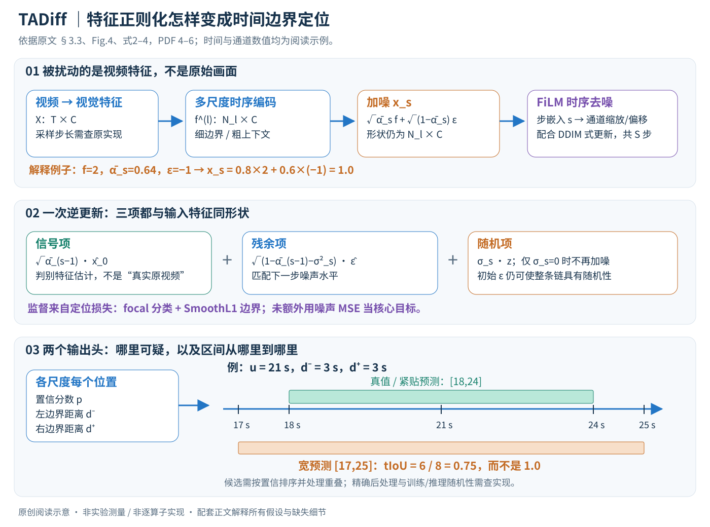
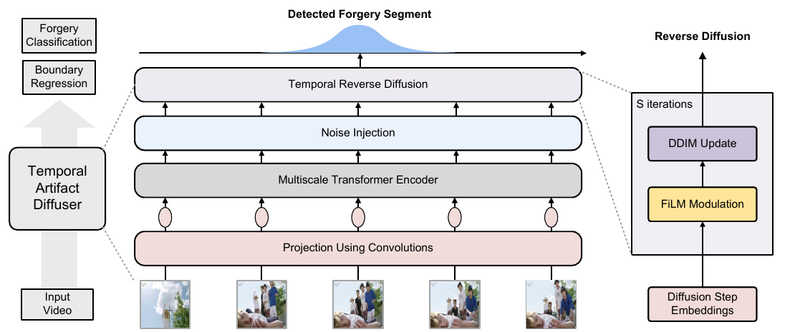

# ActivityForensics: A Comprehensive Benchmark for Localizing Manipulated Activity in Videos

核对日期：2026-10-22。实验数值均为作者报告；本地完成原文阅读与讲解自检，未复现实验。

方法详细版返工：2026-10-23。重读§3与实验，核对FiLM、扩散更新和边界定位；通用公式/数值示例与论文明确分开，未复现。

配图详细版返工：2026-10-23。原创SVG经浏览器逐张检查，核对连线、标注与数值例子；原文图仅作为带出处的对照。

## 一句话总结

ActivityForensics把“视频是否被改过”细化为“哪段活动被生成或编辑过”，并提出TADiff，以特征加噪与少步去噪改善伪造活动的时间边界定位。（PDF第1–5页）

## 研究背景与动机

只输出整段视频真假标签，不能告诉使用者哪段行为受到修改。局部活动编辑可能保留人物、背景和大部分帧，检测器需要同时识别异常活动并定位起止时间。该论文构建的是受控生成与编辑基准，不是对任意网络视频的事实核查系统；未检测到操纵也不能证明视频叙事真实。（PDF第1–3页）

## 方法总览



中文重绘展开特征加噪、逆更新的三项与边界解码。时间轴中21秒及区间均是阅读示例，用来说明tIoU；图中没有虚构实验曲线。依据§3.3、Fig.4、式2–4，PDF第4–6页。



原论文Fig.4，PDF第5页。仅裁切相关图示，保留图内科学标签；著作权属于原作者，用于本篇方法分析，不并入本站原创图授权。[来源与作者](https://openaccess.thecvf.com/content/CVPR2026/html/Bao_ActivityForensics_A_Comprehensive_Benchmark_for_Localizing_Manipulated_Activity_in_Videos_CVPR_2026_paper.html) · [PDF](https://openaccess.thecvf.com/content/CVPR2026/papers/Bao_ActivityForensics_A_Comprehensive_Benchmark_for_Localizing_Manipulated_Activity_in_Videos_CVPR_2026_paper.pdf)。点击可打开高清图。

### 先分清：一个数据基准，加一个定位模型

ActivityForensics是受控构建的视频活动操纵数据集，TADiff是作者在此基准上提出的定位方法。数据构建时需要原视频、描述、生成/编辑工具与时间标注；模型预测时接收待检查视频，不需要再调用生成器改写它。把这两条流程混在一起，会误以为检测器通过生成一个“正确视频”来比较，本文实际并没有这样做。（§3，PDF第3–5页）

定位模型的输出是一组可疑时间区间与置信度，而不是“这个人做了哪种动作”的动作标签，也不是恢复出的原视频。假设60秒视频中有18–24秒被修改，模型应输出接近[18,24]的一段，而不是只给整片一个真假分数。这里的时间与数值是解释例子，不是数据集测量结果。

| 符号 | 形状或含义 | 作用 |
|---|---|---|
| \(V=\{v_t\}_{t=1}^T\) | 输入视频帧序列 | 待定位素材 |
| \(X\in\mathbb R^{T\times C}\) | 视觉骨干提取的时序特征 | 论文为简化与帧序列共用T；实际采样步长需核查 |
| \(f^{(l)}\in\mathbb R^{N_l\times C}\) | 第l级特征金字塔 | 不同时间分辨率的上下文 |
| \(x_s,\hat x_0,\hat\epsilon\in\mathbb R^{N_l\times C}\) | 带噪特征、去噪特征估计、残余噪声估计 | 同一尺度内的扩散更新 |
| \(s,S\) | 扩散时刻和采用的更新步数 | 与视频时间索引t分开 |
| \(p_{l,j},d^-_{l,j},d^+_{l,j}\) | 某时间位置的操纵置信与左右边界偏移 | 解码候选片段 |

最后一行采用便于说明的自定义符号；正文只说明两类输出，没有逐项列出其实现张量。下文涉及采样、时刻缩放及后处理的通用定位知识会明确标为补充，不能作为本文全部实现细节。（PDF第4–6页）

### 图4应该沿哪条路径读？

从底部的视频与卷积投影开始，向上经过多尺度Transformer，再进入特征加噪和反向去噪，最后由分类头和边界头产生区间。右侧放大图是反向链中的一步：扩散步嵌入控制FiLM调制，时序卷积去噪器给出更新所需预测，再做DDIM式状态更新，重复S次。图里被加噪的是隐特征，不是原始RGB画面；“逆扩散”也不代表撤销真实世界发生的篡改。（PDF第5页）

## 核心创新与关键设计

### 1. 数据怎样提供监督：时间边界不需要检测器自己猜标签

作者先用视频描述和时间grounding定位原活动区间，再对描述做语义改变，用生成模型生成整个片段或用编辑模型修改片段内区域，最后把结果并回原时间轴。这样在构建阶段就知道哪段被替换，起止时间成为定位标签。（§3.1，PDF第3–4页）

检测器学习的不是“画面里出现某种行为就算伪造”，而是给定视觉证据下的操纵区间。因此训练样本中真实和操纵部分最好保留相近场景与人物，否则模型容易把背景、事件类别等当成捷径。这也是作者讨论semantic bias的原因。不过“自动拼接”仍可能产生边缘接缝或压缩差异，标注精确不等于没有捷径；原素材分割隔离、质量人评等细节在补充材料，本轮没有核查。

数据涵盖Wan、Scifi、FCVG、VACE、LTX及只用于测试的Vidu。原文称分布均衡，但图3计数1,437/1,152/1,559/1,061/1,058/265明显不同，不应理解为每个生成器数量一样。超过60%的操纵片段不到视频总时长30%，只做整片分类难以提供有用的定位结果。（PDF第4页）

### 2. 多尺度时序特征：为什么不是逐帧单独判真假？

视觉骨干把画面转为X，再通过卷积投影与ActionFormer式多尺度Transformer得到 \(f^{(l)}\)。时间维较细的尺度保留边界附近的变化，较粗的尺度覆盖更长活动与上下文。短促手势和持续十余秒的修改未必适合相同时间感受野，因此用金字塔让不同长度都能形成候选。（PDF第5页）

**形状例子（仅解释）。** 若某段视频被采成128个特征时刻，一个示意金字塔可以是128×C、64×C、32×C。这里的层数与减半规律不是作者正文公布配置，只用于理解N_l变化、C保持。某级第j个位置代表原时间轴上的一个参考位置及上下文，不等于仅看那一帧。

注意力让各位置读取时间上下文，但其表示可能偏向“跑步”“拿东西”等高层语义。此类语义有助动作分类，却未必区分真实动作与合成同类动作。TADiff插在Transformer之后、预测头之前，改变的是用于判断的特征，而非重做整个时序骨干。

### 3. 前向加噪：公式里的两个系数控制什么？

对任一尺度f，原文式(2)为

\[
x_s=\sqrt{\bar\alpha_s}f+\sqrt{1-\bar\alpha_s}\epsilon,\qquad\epsilon\sim\mathcal N(0,I).
\]

\(\bar\alpha_s\)控制原特征保留程度；越接近1，信号占比越高，越接近0，噪声占比越高。两项都与f同形状，所以不会改变时间位置数或通道数。原文描述线性噪声日程，但没有在正文列出端点、所有离散时刻和跳步选择；不能把任意常见DDPM默认值直接写成本文配置。（PDF第5页）

为什么是平方根？作为扩散背景补充，若原特征和噪声独立且方差为1，这种缩放使两部分方差贡献分别为 \(\bar\alpha_s\) 和 \(1-\bar\alpha_s\)。实际视频特征未必白化到单位方差，因此它不是对实际信噪比的精确保证。

**单通道例子。** f=2、\(\bar\alpha_s=0.64\)、噪声取-1，则 \(x_s=0.8\times2+0.6\times(-1)=1.0\)。它不是把时间上那一帧删掉，而是扰动该位置的表示数值。作者希望噪声打破对语义捷径的稳定依赖，再靠后续监督学会保留有用线索；随机噪声本身并不知道哪些维是“语义”哪些是“伪造痕迹”，所以这是一种正则化动机，不是已证明的完美语义消除。

### 4. FiLM的条件来自扩散步，不是视频内容标签

去噪器由轻量时序卷积与FiLM构成，扩散时刻s先转成步嵌入，再控制中间特征。通用FiLM可以表示为 \(h'_{j,c}=\gamma_c(s)h_{j,c}+\beta_c(s)\)，同一通道的缩放和偏移按条件改变。这个式子是FiLM基础解释，论文正文没有完整列出每层参数化、卷积核和广播细节，不冒充其逐算子实现。（PDF第5页）

为什么需要知道s？同样一个数值偏差，在低噪声时可能应保留，在高噪声时可能应大胆修正；若没有噪声级别条件，一个去噪器更难在各阶段采用一致规则。时序卷积则让修正参考邻近时间特征，补充“这一帧是否与前后变化协调”的信息。FiLM参数受训练优化；预测阶段只是使用训练好的映射，不意味着每个视频都现场调权重。

本文没有给出以真实/伪造标签作为FiLM条件的设定，也没有说明要输入生成器身份。它的目标正是让定位跨生成方式迁移，不能人为添加测试时不可知的生成器类别再称原方案。

### 5. DDIM式更新：恢复的是判别表示，不是原始真相

原文式(3)为

\[
x_{s-1}=\sqrt{\bar\alpha_{s-1}}\hat x_0+
\sqrt{1-\bar\alpha_{s-1}-\sigma_s^2}\hat\epsilon+\sigma_sz,
\quad z\sim\mathcal N(0,I).
\]

第一项把去噪器认为有用的“干净”特征放入下个状态；第二项保留与下一噪声水平匹配的残余成分；第三项控制额外随机性。三项同形状，输出仍是 \(N_l\times C\)。\(\hat x_0\)的0是扩散噪声时刻的基准，不是视频第0帧。即使去噪成功，它也不是对原始真实视频的恢复，而是服务定位的特征估计。（PDF第5页）

通用噪声预测扩散常用 \(\hat x_0=(x_s-\sqrt{1-\bar\alpha_s}\hat\epsilon)/\sqrt{\bar\alpha_s}\)把噪声估计转换成原信号估计。将它列在这里是解释两类量为何相关；本文正文没有完整说明去噪器究竟独立输出两者、只预测一种后换算，还是采用其他参数化，因此不能把这个通用关系直接当作作者代码路径。

只有 \(\sigma_s=0\) 时，每次逆更新在给定输入与网络下没有额外随机采样；若起始x_s由随机ε得到，整个过程仍可能随种子变化。正文多次称deterministic，同时保留由η控制的σ项，没有明确给出η最终值。严格复现需核对训练和推理各自的加噪方式、种子、σ和S步时刻序列，不能宣称重复预测一定完全相同。（PDF第5–6页）

### 6. 位置预测怎样变成时间区间？

每个尺度的每个时间位置都接两个头：一个输出被操纵的置信分数，一个输出到起点和终点的偏移。用自定义符号表示，若该位置在原视频上的中心时刻为u、左右距离为d⁻和d⁺，概念区间便是 \([u-d^-,u+d^+]\)。如果距离在特征格点单位，还需乘该尺度时间步长；实际中心定义、偏移单位与有效范围由ActionFormer配置决定，正文没有逐项列出。（PDF第5–6页）

**贯穿例子。** 在60秒视频中，某位置对应u=21秒，预测左3秒、右3秒，便得到[18,24]；附近位置也可能给出[18.2,24.1]等候选。分类置信告诉系统如何排序，边界头决定范围。多尺度可产生重叠候选，通常需要阈值和去重处理；这属于定位系统的必要后处理背景，本文正文没有给出精确NMS类型与阈值，不在笔记中假装已核查。

为什么不能直接给每帧真假然后连起来？逐帧标签容易产生孤立噪声，对边界位置的监督也不同；边界回归让位置特征直接学习区间长度与起止偏移。不过原文未提供与所有逐帧方案的等配置比较，不能仅凭这一设计断言它总更好。

### 7. 不用常见的噪声MSE，去噪器怎么学？

总目标是 \(L=L_{cls}+L_{reg}\)，分类采用focal loss，边界采用SmoothL1；正文明确只用定位目标训练去噪过程，不另加“重构原始RGB”或标准噪声预测MSE。（式4，PDF第6页）

Focal loss的通用形式为 \(-\alpha_t(1-p_t)^\gamma\log p_t\)，降低简单样本的相对权重，适合真实时间位置多、操纵位置少的情况。这里的α_t/γ是损失函数常见记号，与扩散累计α不同；作者正文未公布focal超参数和精确采样权重。SmoothL1在小偏差处近似平方、大偏差处近似线性，让边界误差较大时不被少数离群项完全主导。具体分段阈值、正样本分配与归一化也需读补充实现，不能补默认值。

梯度路径可以概括为：区间预测有错→预测头梯度→S步去噪计算→FiLM/时序卷积→多尺度特征。在参数被配置为可训练的部分继续更新；论文称端到端，但正文没有充分列出上游视觉骨干是否预提取/冻结，因此不能断言所有RGB骨干权重都更新。噪声采样本身没有可训练参数，网络学习的是在受扰动输入下，怎样仍做好定位。

这也解释“artifact-enhanced”的含义：由任务损失塑造的特征被作者解释为更利于捕捉伪造线索，而不是网络受到一个独立的“真实伪造痕迹图”监督。若只照原特征做MSE去噪，甚至可能把原有语义偏差一起恢复；本文避免让这种恢复成为唯一目标。

### 8. 把训练和推理分开看

```text
训练样本 = 视频特征 + 被修改时间区间
多尺度编码 → 每级特征f
按噪声日程得到带噪状态x_s
重复S步：步嵌入 → FiLM时序去噪器 → DDIM式更新
分类头与边界头输出候选
对标签计算focal与SmoothL1 → 更新可训练模块
```

推理时没有真实边界标签，也不反向优化当前视频；使用训练好的定位网络输出置信与区间，再解码/排序。默认S=3是作者实现设置，但测试时是否保留随机初始噪声、怎样配置η等仍需实现核对，不能把训练阶段的随机过程不加区分地写成确定推理代码。AdamW、batch16、学习率0.001是正文明确给出的训练配置，其余遵循ActionFormer与补充材料。（PDF第6页）

成本上，TADiff比基础定位器增加去噪卷积和多步更新；重复S次不会凭空变成零成本。若每步处理所有金字塔特征，其工作量至少与所有层时间位置总数及S有关，精确复杂度还取决于卷积层数、核大小和通道。正文没有速度/显存对照表，不能给本地硬件承诺毫秒级延迟。

### 9. 设计理由要与消融证据一一对应

仅加噪时，同分布AP70.67→70.38，反而略降；只去噪73.52，完整75.05。开放生成器协议则77.82→79.75（只噪声）、80.10（只去噪）、83.64（完整）。因此网络既需要扰动也需要学得的修复，不能把改进简单归结为“噪声有利”或“扩散天然去掉语义”。（表4，PDF第7页）

S=3同分布75.05，S=4为75.18，S=5为74.86；更多步并非持续更好。Fig.7的t-SNE和Fisher比1.74→2.64支持某种判别分离改善，但不能证明完全语义不变，更不能保证遇到新生成器一定成功。保留这一边界，比把方法动机写成已证明定理更准确。（PDF第7–8页）

### 10. 一个边界例子说明指标为何严格

如果真值为[18,24]、预测[17,25]，交集6秒、并集8秒，tIoU为0.75。它可能达到0.75阈值的边缘，却达不到0.85或0.95；具体“等于阈值”是否算成功以评价代码为准。本文报告高阈值AP，因此不只要求找到大致活动，还要求边界紧贴。若把预测缩成[20,22]，虽然完全落在真值内，交并比只有2/6，也不能算高质量覆盖。

这种指标衡量的是与受控操纵标签的重合，不是对现实事件真实性的法律或事实裁定。跨生成器B→A平均AP仍40.89，正说明特征正则没有解决所有迁移问题；模型应输出可疑区间供进一步核查，不能据分数直接断言人物行为真实或虚假。（PDF第6–8页）

## 实验与关键结果

实验用AdamW、batch16、学习率0.001、默认3步去噪。AP在时间IoU阈值0.75/0.85/0.95下取平均，AR对1/5/10个候选取平均；这些都是时间定位指标，不是视频分类准确率。（PDF第6–7页）

| 协议 | ActionFormer AP | TADiff AP | ActionFormer AR | TADiff AR |
|---|---:|---:|---:|---:|
| 同生成器分布 | 70.67 | 75.05 | 74.31 | 77.15 |
| 未见Vidu生成器 | 77.82 | 83.64 | 83.31 | 87.92 |
| A→B跨生成器 | 67.18 | 69.63 | 72.14 | 74.91 |
| B→A跨生成器 | 37.14 | 40.89 | 51.03 | 52.56 |

表2–3（PDF第6–7页）。其中A含Wan、Scifi及VACE，B含FCVG与LTX，所以不能简单等同于“纯生成→纯编辑”。严格tIoU0.95下，同分布AP从46.79升至56.57，开放协议从57.08升至69.06。开放协议数值更高可能来自测试素材难度差异，不能推导现实开放世界更容易。

## 消融实验与证据强度

表4中，同分布基线AP70.67，只有加噪70.38，只有去噪73.52，两者结合75.05。仅加噪甚至略降，说明不能把改进全部归因于“噪声增强”；开放协议对应77.82、79.75、80.10、83.64。（PDF第7页）

图5还显示正文与曲线的细微差异：作者文字称3步最好，但同分布曲线3步75.05、4步75.18，开放协议3步83.64、4步83.99。应把3步理解为接近最优的成本选择，而不是严格数值最高。t-SNE与Fisher比值1.74→2.64提供表征变化的证据，仍不能证明对未来生成器普遍有效。（PDF第7–8页）

## 局限与讨论

跨生成器B→A的AP仍只有40.89，说明分布迁移没有解决。受控拼接、压缩和生成后处理是否形成捷径，需要额外测试。正文未充分说明同一原视频、人物或场景是否跨训练测试隔离；若存在近重复，评估可能偏乐观。真实未操纵负样本的误报、自然剪辑与恶意编辑的区分、全新生成器长期泛化都不应由当前结果代替。系统输出可作定位线索，不能直接作为对个人行为的事实判定。（PDF第3–8页）

## 复现提示

[作者项目页](https://activityforensics.github.io)可用于后续核查数据协议和代码。本轮未核查发布文件的许可证、下载条件、代码commit与补充实验，也未下载视频或运行模型。建议数据放在仓库外的`datasets/video-forensics/activityforensics/`，保留原视频ID、片段边界、生成器、分割规则与文件校验。复现时应先审计来源隔离，再核对特征骨干、采样步长、proposal后处理以及AP阈值；正文未明确的配置不能自行补全后宣称严格复现。（PDF第3–7页）

## 相关工作与阅读顺序

先读时间动作定位中ActionFormer的多尺度特征与边界回归，再读视频伪造检测的跨生成器评估。最后对照扩散去噪理解TADiff：它使用扩散思想正则化定位特征，最终产品是操纵活动时间段，而不是生成视频或还原原视频。结合数据协议阅读表2–3，比单看平均AP更能理解贡献边界。（PDF第2、5–7页）

## 来源与校验

- [CVF官方论文页](https://openaccess.thecvf.com/content/CVPR2026/html/Bao_ActivityForensics_A_Comprehensive_Benchmark_for_Localizing_Manipulated_Activity_in_Videos_CVPR_2026_paper.html) · [所读PDF](https://openaccess.thecvf.com/content/CVPR2026/papers/Bao_ActivityForensics_A_Comprehensive_Benchmark_for_Localizing_Manipulated_Activity_in_Videos_CVPR_2026_paper.pdf)。页码均为PDF页序。
- 所读版本：2026-10-22从CVF下载的开放接收稿；PDF SHA-256：`883815564464a047404a4f34572e8619f3223b45aa7fb36b447be256a9c005b3`。
- 阅读范围：正文、方法公式、实验与消融；补充材料、代码及权重未逐项核验。reviewed表示本地讲解自检，不表示独立同行评审或实验复现。
- 方法图与关键公式/表格已渲染核对，所引原图已单独检查；未对新文章进行浏览器交互验收。作者图示与本站原创素材权利分开记录。
