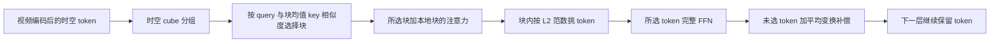

# AdaSpark：按内容分配长视频模型的计算

论文：**AdaSpark: Adaptive Sparsity for Efficient Long-Video Understanding**，Handong Li、Zikang Liu、Longteng Guo 等，CVPR 2026，40548–40558页。完整作者见官方页与manifest。

[官方论文页](https://openaccess.thecvf.com/content/CVPR2026/html/Li_AdaSpark_Adaptive_Sparsity_for_Efficient_Long-Video_Understanding_CVPR_2026_paper.html) · [原文 PDF](https://openaccess.thecvf.com/content/CVPR2026/papers/Li_AdaSpark_Adaptive_Sparsity_for_Efficient_Long-Video_Understanding_CVPR_2026_paper.pdf)

分类：视频 / 长视频理解 / 稀疏计算。最后核对：2026-10-20。正文阅读与讲解自检完成，未执行代码、未复现实验；页码为PDF页码。

## 一句话总结

把视频token按时空立方块分组，注意力动态挑选相关块，FFN只精确处理块内较重要的token并给其他token补偿更新，减少计算而保留token在后续层继续被使用的机会。

## 研究背景与动机

长视频带来两类开销：注意力比较大量token对，FFN逐token做昂贵变换。直接删帧或删token可能错过短暂细节；固定窗口稀疏注意力又可能阻断远处相关事件。[§1，PDF 1–2]

论文观察到注意力分布集中程度因层而异，许多视觉token经过FFN后的变化相对平缓。因此它不把“每个位置、每一层同样预算”当默认，而让稀疏度随内容变化。这一观察支持研究方向，却不是“范数小的token永远不重要”的普遍定理。

## 方法总览

依据Fig.2及§3重绘。文本token的FFN保持稠密，不能把视觉token的计算节约率直接套给全部文本生成阶段。

## 核心创新与关键设计

### 1. 先把视频的一维序列还原成时空邻域

将视觉token按 \(h\times w\times t\) 分成cube，同一cube的token在空间时间上接近，便于用块级摘要做选择。它利用局部相关性，但空间相邻并不保证同一语义；细物体或突变可能跨块边界。[§3.1，PDF 3]

### 2. 注意力按累计概率选择数量可变的块

对查询 \(q\)，与每个前序cube的平均key \(\bar k_j\) 计算：

\[
P(j\mid q)=\operatorname{softmax}_j(q^\top\bar k_j/\sqrt{d_k}).
\]

把概率排序，取累计概率达到阈值 \(p\) 的一组块，再对这些块的实际key/value做注意力；本地cube内符合因果顺序的token始终参与。[式1–3，PDF 3–4]

固定top-k无论信息分布如何都取k个；top-p遇到平坦分布需要更多块，遇到尖锐分布可取更少。论文称之为entropy-aware，但正文并没有额外用显式熵公式求预算；这里的自适应来自累计概率选择。也不能误解为生成文本时随机采样词的top-p解码。

### 3. FFN部分计算，并给跳过的token补偿

块内以归一化L2范数作为重要度：

\[
s_j=\frac{\|x_j\|_2}{\sum_{k\in C_i}\|x_k\|_2+\epsilon}.
\]

按top-p选出集合 \(M_i\)。被选token做完整FFN；其他token不直接丢弃，而加上被选token的平均FFN变换：

\[
y_j=x_j+FFN(x_j),\quad j\in M_i;
\qquad y_k=x_k+\frac1{|M_i|}\sum_{j\in M_i}FFN(x_j),\quad k\notin M_i.
\]

对应式4–7，PDF 4–5。平均补偿让跳过者也更新，但只是近似，不是与稠密FFN等价。token保留不等于信息完全无损。

## 实验与关键结果

基于Qwen2.5-VL-3B和7B后训练，覆盖VideoNIAH、MLVU、VideoMME、LongVideoBench、LVBench、MVBench、VsiBench与CharadesSTA。[§4，PDF 5–6]

主结果Table 1（PDF 6）的3B模型在VideoMME为63.5，原骨干61.5，同数据SFT骨干60.3；7B为66.2，原骨干65.1，同数据SFT骨干64.7。长视频检索VideoNIAH的7B结果为97.5，对应原骨干83.0。它说明所测设置下能兼顾性能与稀疏，但检索任务不等同于完整长视频因果理解。

最关键的计算量对照来自Table 2（PDF 7，已渲染核对），为特定消融设置：

| 稀疏模块 | TFLOPs↓ | MLVU↑ | VideoMME↑ | CharadesSTA mIoU↑ |
| --- | ---: | ---: | ---: | ---: |
| 都关闭 | 299.5 | 65.2 | 60.3 | 43.6 |
| 只开FFN | 216.9 | 63.9 | 62.8 | 41.7 |
| 只开Attention | 213.1 | 66.0 | 61.2 | 43.7 |
| 两者都开 | 128.5 | 65.4 | 62.1 | 44.2 |

\((299.5-128.5)/299.5\approx57.1\%\)。这是该测量设置的**FLOPs下降**，不是实测墙钟时间缩短57%或吞吐提升2.33倍；路由、排序、访存与稀疏算子实现会影响真实速度。

主训练配置最大视觉序列48K、上下文64K；额外NIAH测试另用4096帧、224分辨率、约300K上下文。[§4、§4.2，PDF 5–6] 这些是不同实验，不能合成“默认原生分辨率无限长视频”能力。

## 消融实验与证据强度

单开FFN让MLVU与CharadesSTA下降，说明节省局部特征计算会损害部分时间敏感任务；两组件结合的结果支持互补，而非任一模块独立改善所有基准。[Table 2]

Table 3固定64-token块比较形状，4×4×4在时间相关任务总体稳健，但8×8×1的VideoMME为54.2，略高于4×4×4的54.0，并非所有分数都赢。扩大块尺寸至256在所测三任务表现较好；加入均值补偿后，CharadesSTA从35.0到36.1、VideoMME从54.1到55.7。[PDF 7]

Fig.4比较匹配平均稀疏度的top-k与不同top-p设置，作者选p=0.7作为折中；层间保留比例也不同。这是基于样本的经验选择，不是对所有模型尺度和任务的最优保证。

## 局限与讨论

正文没有独立limitations小节。根据方法，块均值可能掩盖少数关键token，L2范数只是重要性代理，平均补偿可能抹平局部差异；保留所有token仍需承担相应状态存储，不能从FLOPs下降直接推断显存同比下降。

方法经过后训练，不能作为无需训练、可随意插入任意模型的已验证插件。主结果加入了额外训练数据和上下文扩展；同数据SFT与MoBA对照有助于判断贡献，但真实部署仍需在相同硬件、视频编码和输出长度下测量端到端延迟。

## 复现提示

正文主配置：4 fps，cube为8×8×4，Attention与FFN的p均为0.7；视觉编码器冻结，学习率 \(2\times10^{-6}\)，总batch256，32张H100训练约4天。数据包括LLaVA-Video-178K及约77K时间戳定位样本。[§4，PDF 5]

消融另使用3B、24K视觉上下文、2 fps、224×224图像，与主配置不同；Table 3还单独比较块形状和大小，不应把其256-token最优块替换成主配置后宣称论文完全同设。[§4.3，PDF 6–7]

实际复现先验证cube排列与因果mask正确，确保不读取未来token；核对top-p的边界、空集合防护、文本处理和平均补偿，再测相同序列长度的稠密对照。本轮未审查代码仓库、许可证、commit与稀疏kernel，未运行模型，补充材料未读，不提供未经核验的安装或提速承诺。

## 相关工作与阅读顺序

ToMe与FrameFusion代表合并或删token；MoBA和NSA代表块级稀疏；AdaSpark同时考虑块选择与FFN部分更新。与永久删除相比，它保留后续使用的机会，但仍以近似计算换取效率。

建议 Fig.2 → 式1–3 → 式4–7 → Table 2 → Table 3 → Table 1 → §4.2长上下文测试。先理解计算到底省在哪里，再解释“57%”的测量范围。

## 来源与校验

依据CVF公开接收版正文1–8页；Table 2–3所在第7页已渲染查看；补充材料未读。PDF SHA-256：`9d8c1fe7931876e94d6c3b4b7882e6d73c2c1f16ecb3657ba9360bfc64bbf33c`，为本地摘要。图为独立重绘，不转载作者图片和原文全文。AI辅助讲解已自检，无独立专家审稿，未复现实验。
