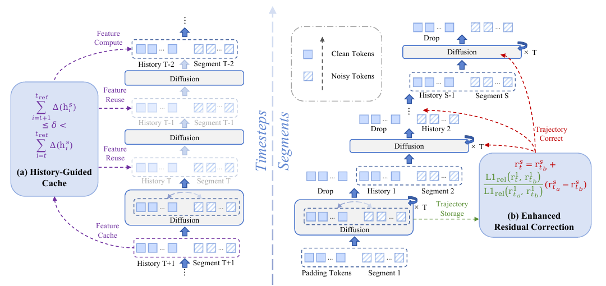

# Accelerating Autoregressive Video Diffusion via History-Guided Cache and Residual Correction

核对日期：2026-10-20。以下实验均为作者报告；本地完成原文阅读与讲解自检，未复现实验。

## 一句话总结

ARCache用历史token变化安排片段内缓存刷新，再用首片段残差轨迹调节后续片段的残差外推，减轻自回归视频生成中缓存误差累积。

## 研究背景与动机

自回归视频扩散把前段结果当成后段条件，因此前段缓存近似误差可能反复传播。普通缓存只看整体输入变化或固定间隔，难判断历史条件对当前输出的影响。[§1–2，PDF1–2]

它减少模型块重算，不是减少视频段数，也不是把所有段完全并行；序列依赖仍然存在。

## 方法总览

HGC监测相邻去噪步的history token变化，累计超过阈值δ时重算、更新缓存。ERC保存第一段残差轨迹，在后段的两个最近重算残差之间，以首段提供的轨迹系数做外推。[Fig.2、§3，PDF3–5]

首段没有先前片段误差，但自身仍可能有模型误差和缓存误差；“clean reference”是相对低误差参考，不是外部干净真值。

图：原论文 Fig.2，PDF第3页。仅裁去页边及无关正文，图内内容未改；著作权属于原作者，用于本篇方法分析，不按本站原创图重新授权。[原文与作者信息](https://openaccess.thecvf.com/content/CVPR2026/html/Nan_Accelerating_Autoregressive_Video_Diffusion_via_History-Guided_Cache_and_Residual_Correction_CVPR_2026_paper.html) · [PDF](https://openaccess.thecvf.com/content/CVPR2026/papers/Nan_Accelerating_Autoregressive_Video_Diffusion_via_History-Guided_Cache_and_Residual_Correction_CVPR_2026_paper.pdf)。点击可查看高清图。

## 核心创新与关键设计

历史变化\(\Delta(h_t^s)=\|h_t^s-h_{t+1}^s\|_1/\|h_{t+1}^s\|_1\)，累积超阈值触发刷新。这里history token需按模型内相应位置理解，并非直接拿不随去噪变动的历史原图做差。[式3–4，PDF4]

ERC写作\(r_t^s=r_{t_b}^s+\lambda_t(r_{t_a}^s-r_{t_b}^s)\)，其中\(\lambda_t=L1rel(r_t^1,r_{t_b}^1)/L1rel(r_{t_a}^1,r_{t_b}^1)\)，s>1。[式5–7，PDF5]

首段如何在每个需要的时间点存到残差、首段自身被缓存时如何得到可靠轨迹、分母接近零如何处理，正文未完全展开。比值是距离比，不是带符号的精确时间插值，不能保证方向和曲率都匹配后续段。

## 实验与关键结果

H10080GB；FramePackF1为145帧25步，SkyReelsV2为257帧30步960×544，MatrixGame为113帧50步1280×720。相对未加速输出评PSNR/SSIM/LPIPS，另用任务质量分。[§4.1，PDF6]

| 作者报告 fast模式 | 原始延迟秒 | fast延迟 / 加速 | fast任务分 vs 原始 |
| --- | --- | --- | --- |
| FramePackF1 | 146.42 | 50.81 / 2.88× | 88.81 vs 88.45 |
| SkyReelsV2 | 358.41 | 191.66 / 1.87× | 77.04 vs 77.59 |
| MatrixGame | 495.84 | 158.51 / 3.13× | 79.07 vs 80.32 |

来源Table1，PDF7。视频计时段长分别5/10/2秒，不可跨模型把延迟当同一工作量。slow的高保真结果不能与fast最高加速拼成一个配置；fast任务质量在后两项下降。PSNR参照原模型输出而非真实未来视频。

## 消融实验与证据强度

FramePack200对子集消融：HGC δ0.1的PSNR24.13、1.52×；δ0.3为20.89、2.88×。加ERC后24.13→24.79，SSIM0.8169→0.8266，延迟96.40→96.74秒。[Table2，PDF8]

该消融PSNR与完整大样本Table1 slow28.13不同，属于不同评价子集，不能无说明混合。“无需训练”仍需手动调阈值，作者把去除阈值列为未来方向。TaylorSeer在H10080G出现OOM只说明报告设置的内存边界，不能泛称该方法所有环境不可运行。

## 局限与讨论

首段与后段残差演化相似是经验条件，剧情切换、动作突变或交互输入变化可能破坏它。相关分析不等于历史变化在所有模型上都能界定误差；没有无限长度视频的误差上界。

缓存轨迹增加内存和实现复杂度，GPU、分辨率、调度器、精度都会改变收益。主表任务分小幅变动缺少置信区间，不能把高于原始的小差异直接当质量提升定论。

## 复现提示

建议 `experiments/arcache/`，固定模型/权重、输入seed、采样器、首段策略、缓存层、δ和分母稳定规则，记录逐段/逐帧保真、刷新率、峰值显存和端到端时间，特别测试首段异常与中途场景变化。

所读正文未核验本方法代码入口、commit和许可证，未下载或运行视频模型；本文数据均为作者报告，未消耗付费API。

## 相关工作与阅读顺序

先读特征缓存与自回归条件依赖，再看TeaCache、TaylorSeer的刷新/预测区别。读本篇时把片段内HGC和片段间ERC分开，最后对照fast/slow和消融子集，避免混用加速与保真数据。

## 来源与校验

- [CVF 官方论文页](https://openaccess.thecvf.com/content/CVPR2026/html/Nan_Accelerating_Autoregressive_Video_Diffusion_via_History-Guided_Cache_and_Residual_Correction_CVPR_2026_paper.html) · [所读 PDF](https://openaccess.thecvf.com/content/CVPR2026/papers/Nan_Accelerating_Autoregressive_Video_Diffusion_via_History-Guided_Cache_and_Residual_Correction_CVPR_2026_paper.pdf)。页码均为该 PDF 的页序。
- 阅读范围：正文、公式与实验表；补充材料、上游代码与权重未逐项核验。许可证和固定代码 commit 尚未确认，不复制原文全文或数据。
- PDF SHA-256：`827347323be76ea4d7ec8d709b029e4fd2edd6bc9ad9592c1d117572fae639f0`；版本为本次下载的 CVF 接收稿，核对日期 2026-10-20。
- 视觉核对：PDF第3页及所引流程图已渲染检查；本地未复现实验。
