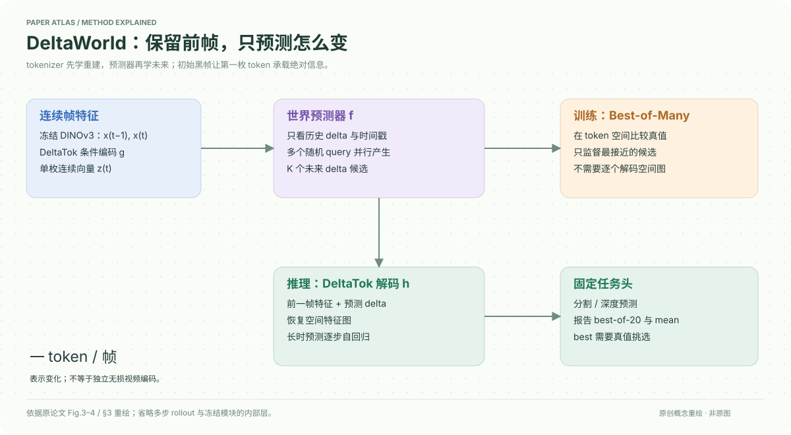

# A Frame is Worth One Token: Efficient Generative World Modeling with Delta Tokens

核对日期：2026-10-20。以下实验均为作者报告；本地完成原文阅读与讲解自检，未复现实验。

## 一句话总结

DeltaWorld把相邻帧的DINO特征变化压成一个连续delta token，并用Best-of-Many训练并行预测多种未来；它压缩的是任务特征变化，不是无损视频码流。

## 研究背景与动机

确定性世界模型容易平均掉多种未来，逐像素生成多种未来又很昂贵。相邻视频帧有大量共同内容，模型可保留前帧特征，只描述如何变化，而不重复预测整张空间网格。[§1–3，PDF1–5]

标题“一帧一token”不意味着一帧的全部视觉信息独立藏在一个标量：token是高维连续向量，解码还依赖前帧特征与已训练解码器。

## 方法总览

冻结DINOv3提取x_{t−1},x_t；DeltaTok编码成z_t，解码器利用前帧特征和z_t恢复当前特征。世界预测器只看delta序列和时间戳，用多个高斯噪声query产生未来delta，训练只监督最接近真值的候选，推理再解码到特征图，接固定分割/深度头。[Fig.3–4，PDF5–6]

## 核心创新与关键设计

关键条件编码为
\[z_t=g(x_{t-1},x_t,z_{init}),\quad\hat x_t=h(x_{t-1},z_t).\]
它不是先显式逐像素相减再平均，而是学习条件压缩。视频前置黑帧，让第一枚delta携带初始绝对信息；未来预测为\(\hat z_{t+1}=f(q_k,Z_{1:t},T_{1:t},\tau_{t+1})\)。[式8–10]

BoM从K个候选中选全局最接近真值者：
\[L_{BoM}=\min_k\ell(z_{t+1},\hat z^{(k)}_{t+1}).\]
世界预测器在token空间计算此损失，不必训练时把每候选还原为完整图。训练tokenizer与训练predictor是两个阶段；前者用特征重建MSE。[§3.2–3.4]

“一次前向多未来”指同一目标时刻并行采样；中期预测仍作三步自回归，每步还需新query与后续解码，不等于任意长未来都一次完成。

## 实验与关键结果

约4M视频样本训练，测试VSPW、Cityscapes、KITTI均未入世界模型训练集；但线性任务头另用各测试域的训练split训练。主模型512×512、predictor300k步+5k微调、tokenizer50k步、BoM训练K256，评价20样本。短期约0.2s，中期约0.6s。[§4.1–4.3]

| 作者Table3，中期 | Cityscapes mIoU↑ | VSPW mIoU↑ | KITTI RMSE↓ |
| --- | --- | --- | --- |
| DINO-world单预测（作者重实现） | 49.8 | 47.9 | 4.07 |
| Cosmos12B，best（mean） | 53.3（51.2） | 47.7（45.5） | 4.01（4.14） |
| DeltaWorld，best（mean） | 55.4（51.3） | 50.1（46.7） | 3.88（4.17） |

Best依赖真值从20个候选挑最优，是覆盖能力上界，部署时未必知道该选谁；Mean是先平均空间特征再过任务头，不是20个分数的算术平均。Delta的mean并未全面超过确定性基线。[PDF8]

20样本GFLOPs：Delta3.1×10⁴、Cosmos12B6.4×10⁷，约2000倍差异包含Cosmos额外7B扩散解码器；两者输出空间不同，不应宣传为相同视频画质任务的2000倍加速。

## 消融实验与证据强度

256×256、100k训练、K16消融：Cityscapes中期best/mean，未压缩BoM46.8/31.1，整帧压缩42.7/35.5，delta压缩48.7/45.5。Delta缓解单token瓶颈，mean恢复到确定性基线45.4附近。[Table2，PDF7]

训练时间相对基线，未压缩BoM4.9×，整帧0.4×，Delta0.5×；20样本推理GFLOPs分别12013、631、672。不能因为delta稍贵于整帧压缩就忽略其质量收益，也不能把0.5×训练时间当作全部实验通用值。增加训练query使best提高，mean有轻微下降后趋稳。[Fig.5]

## 局限与讨论

长时滚动会累积误差，单delta容量与前帧依赖对大变化、复杂细节可能有限；这些是由方法结构推得的风险，正式局限讨论在未读附录D。本文没有完成动作条件规划、安全决策或高保真像素生成的完整验证。

Best-of20需要oracle选择，不能当作系统真实可达精度。预训练特征提取与解码仍占计算，token减少1024倍不等于总计算必然减少1024倍。

## 复现提示

先固定DINOv3、输入大小、采样时间戳和tokenizer，再训练predictor；记录黑帧初始化、8帧训练上下文、测试4帧上下文、三步中期滚动与query噪声标准差0.02。评价必须并列Best、Mean、单候选以及总计算范围。

项目页 `https://deltatok.github.io`；本次未核验代码许可、权重commit与附录训练集明细。视频与特征建议 `data/deltaworld/`，不提交数据或权重，本地未训练或复现。

## 相关工作与阅读顺序

先读DINO-world的特征预测，再读Best-of-Many理解多候选监督，最后看DeltaTok与整帧token压缩的对照。可结合4DWorldBench思考评估缺口：分割/深度预测好，并不自动证明完整物理与交互正确。

## 来源与校验

- [CVF 官方论文页](https://openaccess.thecvf.com/content/CVPR2026/html/Kerssies_A_Frame_is_Worth_One_Token_Efficient_Generative_World_Modeling_CVPR_2026_paper.html) · [所读 PDF](https://openaccess.thecvf.com/content/CVPR2026/papers/Kerssies_A_Frame_is_Worth_One_Token_Efficient_Generative_World_Modeling_CVPR_2026_paper.pdf)。页码均为该 PDF 的页序。
- 阅读范围：正文、公式与实验表；补充材料、上游代码与权重未逐项核验。许可证和固定代码 commit 尚未确认，不复制原文全文或数据。
- PDF SHA-256：`d7647c8cf24dd38b5de3d0277756fde098a6b26d1352b4db2593598af6f0f59c`；版本为本次下载的 CVF 接收稿，核对日期 2026-10-20。

- 视觉核对：已渲染查看 PDF 第8页，检查关键实验表、公式或局限；正文读到结论，独立补充材料未读。
