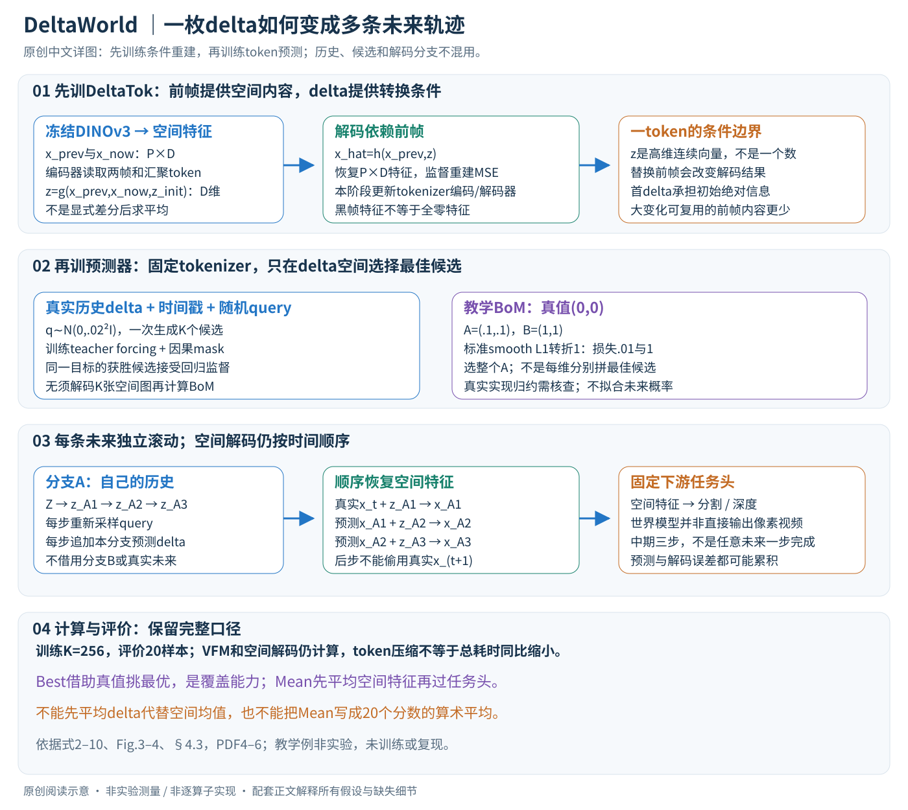

# A Frame is Worth One Token: Efficient Generative World Modeling with Delta Tokens

核对日期：2026-10-20。以下实验均为作者报告；本地完成原文阅读与讲解自检，未复现实验。

方法与配图详细版返工：2026-10-25。展开两阶段训练、BoM选择、独立滚动与顺序解码；未复现实验。

## 一句话总结

DeltaWorld把相邻帧的DINO特征变化压成一个连续delta token，并用Best-of-Many训练并行预测多种未来；它压缩的是任务特征变化，不是无损视频码流。

## 研究背景与动机

确定性世界模型容易平均掉多种未来，逐像素生成多种未来又很昂贵。相邻视频帧有大量共同内容，模型可保留前帧特征，只描述如何变化，而不重复预测整张空间网格。[§1–3，PDF1–5]

标题“一帧一token”不意味着一帧的全部视觉信息独立藏在一个标量：token是高维连续向量，解码还依赖前帧特征与已训练解码器。

## 方法总览

原创图明确区分真实前帧、预测前帧、delta序列和下游空间特征。教学向量不代表学到的token维度或实际实验结果。

### 输入输出与形状：一token仍是高维连续向量

输入是过去视频帧及其实际时间戳，输出是未来的DINOv3空间特征，可交给固定分割/深度头。令冻结VFM输出 \(x_t\in\mathbb R^{H_f\times W_f\times D}\)，每帧有P=HfWf个patch token；DeltaTok输出 \(z_t\in\mathbb R^D\)。上下文T帧在预测器里从T×P个空间token变为T个delta token，但原图特征提取和空间解码并没有消失。（§3.3–3.4，PDF第4–5页）

标题中的“一帧一token”不是一个数或无损压缩码。独立解码一枚z还需要前帧特征与训练好的解码器；给定z却换了前帧，会改变恢复结果。方法预测的是表征，主实验并未直接输出像素视频。

## 核心创新与关键设计

### 第一步：训练DeltaTok学会有前帧条件的重建

\[
z_t=g(x_{t-1},x_t,z_{init}),\qquad
\widehat x_t=h(x_{t-1},z_t).
\]

编码器将两张空间网格和一个可学习汇聚token送入Transformer，让单个输出token吸收转换信息；解码器读取前帧网格与z，输出当前空间特征。按接口理解，编码序列包含约2P+1个token，解码约P+1个token；主文图3没有展开所有位置编码与实现细节，不将此接口数量当完整计算图。（式8–9、Fig.3）

它不是显式计算x_t−x_{t−1}再求均值，也没有规定z是位移、光流或可相加残差。教学上可以类比“已有背景，只补变化”，但不存在可以直接把两个真实delta向量相加就得到跨两帧变化的保证。

训练冻结DINOv3，更新tokenizer编码器和解码器，使恢复特征接近真实x_t。Fig.3明确标MSE，式7记为范数形式；损失按元素求和还是均值的尺度需实现核查，不由简写推定。假设某教学两元素特征真值(1,2)、恢复(.9,2.2)，平方误差和为.05，均方误差为.025，二者差在归约。这里不把该例说成真实tokenizer输出。

### 黑帧起点：第一枚delta承担特殊职责

序列前补黑帧，使第一枚z从黑帧特征过渡到第一张真实图，因而需要承载初始绝对信息。黑色像素输入VFM后的特征不必全零；不能将“黑帧”直接替换成DINO特征全零矩阵。后续z描述真实相邻帧的条件变化，首token与稳态小变化token的压缩压力并不相同。（§3.4）

作者训练时间间隔从[1/25,1/3]秒采样，选择最近实际视频帧并使用实际时间戳，因此z承载的变化随帧间距变化。相机急转、遮挡解除或镜头切换时，前帧能复用的信息更少；架构允许训练这种变化，但单token容量并不保证精确保留全部新细节。

### 第二步：冻结tokenizer，只训练未来delta预测器

\[
\widehat z_{t+1}^{(k)}=f(q_k,Z_{1:t},T_{1:t},\tau_{t+1}),
\qquad q_k\sim\mathcal N(0,0.02^2I).
\]

历史delta、历史时间戳和目标时间告诉预测器“从哪些变化、预测到何时”，随机query使同一历史能产生不同候选。这里q不是文本提示或动作指令。训练tokenizer完成后固定其输出目标，预测器在delta空间接受监督；不会为每个候选都运行空间解码和任务头。（式10、Fig.4，PDF第5–6页）

训练使用teacher forcing：各时刻以真实过去特征编码的delta作为上下文，因果mask防止读到未来目标。多个训练目标可在一次前向中并行计算，不代表目标之间可以相互读取真值。测试自回归时历史里出现模型自己的预测token，训练/测试上下文分布因此不同；多步误差可能积累。

### Best-of-Many：选择一整份候选，不拼接每个位置的最佳答案

\[
k^*=\arg\min_k\ell(z_{t+1},\widehat z_{t+1}^{(k)}),\qquad
L_{BoM}=\ell(z_{t+1},\widehat z_{t+1}^{(k^*)}).
\]

距离用smooth L1；只有获胜候选直接通过本次监督项反传，未获胜候选不各自承担同一目标的回归损失。共享网络参数仍会被获胜分支更新，因此不能理解成其余候选拥有永远不更新的独立网络。argmin的选择本身也不是一个平滑概率模型。

在论文先介绍的未压缩BoM中，先跨全部空间位置求误差再选同一个k；不能每个像素各挑最优分支拼成实际上从未生成过的“未来”。DeltaWorld进一步在单delta向量上选k，避免解码；token距离最小不必严格等价于下游mIoU最高，因为解码器和任务头是另一个映射。（式4与§3.4）

教学真值z=(0,0)，候选A=(.1,.1)、B=(1,1)，若采用转折点为1的标准smooth L1，逐维求和损失为.01与1，选A。真实损失的转折参数和归约须依实现，这只是解释winner选择。BoM奖励“至少有一个候选近”，并不直接拟合每种未来的真实发生概率，也没有单独证明候选间必然多样；增加K改善oracle覆盖不等于校准不确定性。

### 多步预测：每条未来拥有自己的历史与前帧

短期预测直接到约.2秒；中期约.6秒使用三步自回归。K条候选独立滚动，每一步采样新query，并把本分支预测的delta接到本分支历史。不能把A分支的第一步与B分支的第二步混到同一条轨迹。（§4.3，PDF第6页）

预测器滚动全程可以留在delta空间。需要空间任务输出时，解码单独顺序进行：

\[
\widehat x_{t+1}^{(k)}=h(x_t,\widehat z_{t+1}^{(k)}),\quad
\widehat x_{t+2}^{(k)}=h(\widehat x_{t+1}^{(k)},\widehat z_{t+2}^{(k)}).
\]

第二步必须用该分支预测前帧，而非偷偷输入真实未来x_{t+1}；后者会把滚动预测变成teacher-forced评价。不同分支的时间顺序、预测器上下文和解码器前帧都应保持一致。“一次前向多未来”仅指同一目标时刻并行采样，三步滚动并未自动合并成一步。

### 计算节省发生在哪，仍有哪些成本

主设置K=256用于训练、测试抽20样本；两者不同。若P=1024是教学空间网格，T=4，则预测器历史token从4096降至4，但query数量、注意力实现、VFM和DeltaTok都影响总算量，不能宣称整条管线必然快1024倍。K个token输出和损失仍需O(KD)级别的元素工作，只是比K张P×D网格便宜；“几乎没有额外开销”是相对量，不是零成本。

两阶段各自训练，主模型tokenizer 50k步、predictor 300k步再5k低学习率微调；消融采用不同分辨率、步数与K，不能混用训练成本。当前讲解未运行这些训练，也未核验代码commit或附录全部配置。（§4.1）

### 评价的Best与Mean回答不同问题

测试Best从20个候选中借助真值挑最好，衡量有限预算覆盖能力；部署时没有未来真值，不能直接获得这一选择器。Mean先平均空间特征再过固定任务头，不是20个mIoU/RMSE的平均，也不是先平均delta再解码；非线性解码和任务评分一般不与平均交换。

任务头使用各评价域训练split训练，世界模型训练视频未包含这些测试集，两者要分开记录。模型的分割/深度成绩说明对应表征预测能力，不能自动推出动作条件规划、物理守恒或真实机器人决策已验证。（§4.2–4.3）

## 实验与关键结果

约4M视频样本训练，测试VSPW、Cityscapes、KITTI均未入世界模型训练集；但线性任务头另用各测试域的训练split训练。主模型512×512、predictor300k步+5k微调、tokenizer50k步、BoM训练K256，评价20样本。短期约0.2s，中期约0.6s。[§4.1–4.3]

| 作者Table3，中期 | Cityscapes mIoU↑ | VSPW mIoU↑ | KITTI RMSE↓ |
| --- | --- | --- | --- |
| DINO-world单预测（作者重实现） | 49.8 | 47.9 | 4.07 |
| Cosmos12B，best（mean） | 53.3（51.2） | 47.7（45.5） | 4.01（4.14） |
| DeltaWorld，best（mean） | 55.4（51.3） | 50.1（46.7） | 3.88（4.17） |

Best依赖真值从20个候选挑最优，是覆盖能力上界，部署时未必知道该选谁；Mean是先平均空间特征再过任务头，不是20个分数的算术平均。Delta的mean并未全面超过确定性基线。[PDF8]

20样本GFLOPs：Delta3.1×10⁴、Cosmos12B6.4×10⁷，约2000倍差异包含Cosmos额外7B扩散解码器；两者输出空间不同，不应宣传为相同视频画质任务的2000倍加速。

## 消融实验与证据强度

256×256、100k训练、K16消融：Cityscapes中期best/mean，未压缩BoM46.8/31.1，整帧压缩42.7/35.5，delta压缩48.7/45.5。Delta缓解单token瓶颈，mean恢复到确定性基线45.4附近。[Table2，PDF7]

训练时间相对基线，未压缩BoM4.9×，整帧0.4×，Delta0.5×；20样本推理GFLOPs分别12013、631、672。不能因为delta稍贵于整帧压缩就忽略其质量收益，也不能把0.5×训练时间当作全部实验通用值。增加训练query使best提高，mean有轻微下降后趋稳。[Fig.5]

## 局限与讨论

长时滚动会累积误差，单delta容量与前帧依赖对大变化、复杂细节可能有限；这些是由方法结构推得的风险，正式局限讨论在未读附录D。本文没有完成动作条件规划、安全决策或高保真像素生成的完整验证。

Best-of20需要oracle选择，不能当作系统真实可达精度。预训练特征提取与解码仍占计算，token减少1024倍不等于总计算必然减少1024倍。

## 复现提示

先固定DINOv3、输入大小、采样时间戳和tokenizer，再训练predictor；记录黑帧初始化、8帧训练上下文、测试4帧上下文、三步中期滚动与query噪声标准差0.02。评价必须并列Best、Mean、单候选以及总计算范围。

项目页 `https://deltatok.github.io`；本次未核验代码许可、权重commit与附录训练集明细。视频与特征建议 `data/deltaworld/`，不提交数据或权重，本地未训练或复现。

## 相关工作与阅读顺序

先读DINO-world的特征预测，再读Best-of-Many理解多候选监督，最后看DeltaTok与整帧token压缩的对照。可结合4DWorldBench思考评估缺口：分割/深度预测好，并不自动证明完整物理与交互正确。

## 来源与校验

- [CVF 官方论文页](https://openaccess.thecvf.com/content/CVPR2026/html/Kerssies_A_Frame_is_Worth_One_Token_Efficient_Generative_World_Modeling_CVPR_2026_paper.html) · [所读 PDF](https://openaccess.thecvf.com/content/CVPR2026/papers/Kerssies_A_Frame_is_Worth_One_Token_Efficient_Generative_World_Modeling_CVPR_2026_paper.pdf)。页码均为该 PDF 的页序。
- 阅读范围：正文、公式与实验表；补充材料、上游代码与权重未逐项核验。许可证和固定代码 commit 尚未确认，不复制原文全文或数据。
- PDF SHA-256：`d7647c8cf24dd38b5de3d0277756fde098a6b26d1352b4db2593598af6f0f59c`；版本为本次下载的 CVF 接收稿，核对日期 2026-10-20。

- 视觉核对：已渲染查看 PDF 第8页，检查关键实验表、公式或局限；正文读到结论，独立补充材料未读。

- 2026-10-25详细版：重读PDF第4–6页、渲染第5页；原创图上下半部及文章检查通过，6个公式无错误、坏图或横向溢出。
