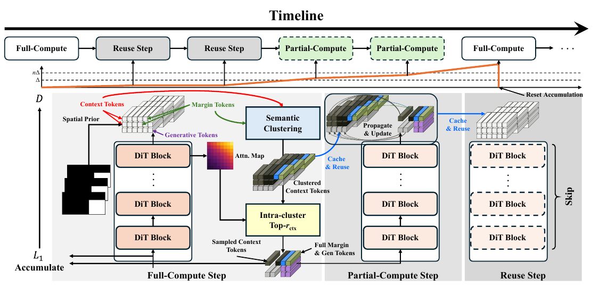

# Accelerating Diffusion-based Video Editing via Heterogeneous Caching: Beyond Full Computing at Sampled Denoising Timestep

核对日期：2026-10-21。实验数值均为作者报告；本地完成原文阅读与讲解自检，未复现实验。

## 一句话总结

HetCache针对带编辑mask的视频扩散，按时间变化在完整计算、部分token计算与缓存复用间切换，并保留编辑区域及其边界附近token。

## 研究背景与动机

视频局部编辑中，生成区域需要细化，边界需要连续过渡，远处背景token则大量重复。仅按整个时间步复用没有利用这种不均匀性；随机删背景又可能丢失对目标区域有用的上下文。[§1–3.2，PDF1–4]

方法依赖明确的ROI/mask，不能直接当作所有无mask文生视频的通用加速器。

## 方法总览

原论文 Fig.2，PDF第4页。仅裁切相关图示，保留图内科学标签，著作权属于原作者；用于本篇方法分析，不并入本站原创图授权。[来源与作者](https://openaccess.thecvf.com/content/CVPR2026/html/Liu_Accelerating_Diffusion-based_Video_Editing_via_Heterogeneous_Caching_Beyond_Full_Computing_CVPR_2026_paper.html) · [PDF](https://openaccess.thecvf.com/content/CVPR2026/papers/Liu_Accelerating_Diffusion-based_Video_Editing_via_Heterogeneous_Caching_Beyond_Full_Computing_CVPR_2026_paper.pdf)。点击可打开高清图。

按mask把token分为生成区、边缘区与远背景。完整计算保存特征及相关注意力；部分计算保留全部生成/边缘token，并按语义聚类及与生成区域的注意力关联选一部分背景；稳定时间步则直接复用缓存。[Fig.2、§3.3，PDF4–5]

聚类既避免所有代表点集中到一种背景，又在每簇挑对生成区更相关的token。保留的“全部生成token”仍只与缩减上下文交互，不意味着其结果等于完整注意力。

## 核心创新与关键设计

相邻调制输入的变化为\(d_t=\|F_t-F_{t+1}\|_1/\|F_{t+1}\|_1\)，其中\(F_t=T_t\odot x_t\)，累计D后按正文使用：D≤Δ复用、Δ<D≤1.5Δ部分计算、D>1.5Δ完整刷新。[式1–2，PDF4–5]

部分计算在K-Means簇内按\(\alpha_i=|X_{gen}|^{-1}\sum_{j\in X_{gen}}\bar A_{ij}\)选top-rctx背景token；注意力序列成本示意由\((X_c+X_m+X_g)^2\)降到\((r_{ctx}X_c+X_m+X_g)^2\)，尚须计入聚类、选择及缓存开销。[式3–5]

**Algorithm1存在可直接定位的条件冲突**：它设τreuse=1.5Δ、τpartial=Δ，先判断缓存非空且D≤τreuse，再else-if D≤τpartial。已有缓存时第二分支不可能触发；首步缓存为空且D=0时反而会进需要缓存的部分计算。不能照抄该伪代码作为可用实现；本解释按正文三范围描述设计意图，正确代码待核。

正文前段称完整步骤聚类，后段与算法称每次部分步骤聚类；其实际刷新频率也需核验。

## 实验与关键结果

Wan2.1-VACE，VACE-Benchmark子集做inpainting，VPBench做文本编辑；主表rctx0.7、K16，详细GPU与采样设置在未读补充材料。[§4.1，PDF6]

| 作者报告：VACE补全 | 原始100步 | 单纯50步 | HetCache-fast50步 |
| --- | --- | --- | --- |
| 延迟秒↓ | 445.52 | 238.84 | 166.81 |
| FLOPs P↓ | 145.21 | 72.60 | 23.60 |
| PSNR↑ | 16.06 | 16.46 | 16.58 |
| VFID↓ | 57.18 | 54.96 | 54.51 |
| VBench↑ | 76.54 | 76.78 | 75.88 |

来源Table1，PDF6。2.67×包含从100步减到50步的收益；相对同50步未缓存基线约1.43×。更低FLOPs不等于同倍率真实时延。VBench低于原始与纯50步，不能称质量各项无损。

表中TeaCache-slow224.53秒和fast186.45秒相对445.52秒约1.98×/2.39×，与表列2.38×/2.53×不符。§4.2又把原始写为342.57秒/108.91P，与主表不同；本笔记按明确列出的主表数值报告，不混合基线。

## 消融实验与证据强度

Table3完整策略VFID54.51，相比不使用两种选择依据54.54仅小幅改善；PSNR16.58略低于16.60，延迟166.81高于142.46。证据支持折中，不支持每项更好。[PDF8]

Table3完整VBench76.29与Table1 fast75.88不一致，需确认子集或设置。更长视频57×480P表列3.06×，高分辨率25×720P2.91×；其他设置虽PSNR更好，LTX的VFID64.50→67.00下降。Δ的slow/fast对应关系也与直观“更大阈值允许更多复用”需核代码确认。

## 局限与讨论

大编辑区域会减少可省的背景token，快速运动或复杂mask可能使缓存相关性失效。聚类与注意力提取开销不能忽略，注意力权重本身也不是严格的因果重要性证明。

算法分支和多个计时/质量口径尚有疑问，不能把精读自检当成确认上游实现正确。LPIPS在文本编辑表标↑，但具体用来评保真还是改动强度未充分解释，不在缺少定义时直接按数值判整体优劣。

## 复现提示

建议 `experiments/video-editing/hetcache/`。先在临时样例检查首步完整计算、三种区间都可到达、D清零与EMA维度，再固定mask宽度、rctx、K、γ、Δ和采样步数；明确比较同50步和不同100步基线。

本次正文未核验可用代码入口、commit和许可证，也未下载权重或执行编辑。先复核伪代码与真实实现再考虑昂贵推理，所有实验仍为作者报告。

## 相关工作与阅读顺序

先读带ROI的视频编辑，再比较TeaCache的时间步复用、token选择和本篇三模式。核心阅读顺序是Fig.2、正文阈值范围、Algorithm1、Table1及Table3，避免把示意设计和印刷伪代码视为完全一致。

## 来源与校验

- [CVF官方论文页](https://openaccess.thecvf.com/content/CVPR2026/html/Liu_Accelerating_Diffusion-based_Video_Editing_via_Heterogeneous_Caching_Beyond_Full_Computing_CVPR_2026_paper.html) · [所读PDF](https://openaccess.thecvf.com/content/CVPR2026/papers/Liu_Accelerating_Diffusion-based_Video_Editing_via_Heterogeneous_Caching_Beyond_Full_Computing_CVPR_2026_paper.pdf)。页码均为PDF页序。
- 所读版本：2026-10-21从CVF下载的开放接收稿；PDF SHA-256：`b83736c863479634e42976be0e4b2cc840244c172b60fa87a7b61fd92e0bd111`。
- 阅读范围：正文、方法公式、实验与消融；补充材料、代码及权重未逐项核验。reviewed表示本地讲解自检，不表示独立同行评审或实验复现。
- 关键公式/算法/表格页面已渲染核对，所引原图已单独检查；作者图示与本站原创素材权利分开记录。
