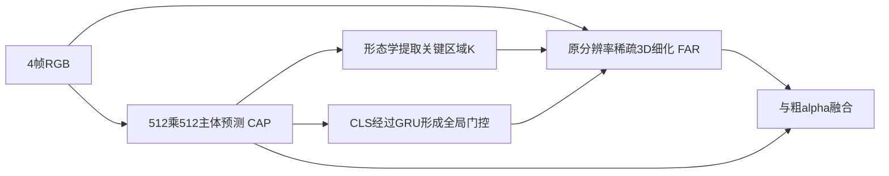

# αMatte4K 与 μMatting：把4K视频抠图算力用在细节上

论文：**$\alpha$Matte4K & $\mu$Matting: Dataset and Model for Ultra-Micro Precision Alpha Video Matting**，Xinyi Chen、Hang Dong、Baowei Jiang等，CVPR2026，12491–12500页。

[官方页](https://openaccess.thecvf.com/content/CVPR2026/html/Chen_alphaMatte4K__muMatting_Dataset_and_Model_for_Ultra-Micro_Precision_Alpha_CVPR_2026_paper.html) · [PDF](https://openaccess.thecvf.com/content/CVPR2026/papers/Chen_alphaMatte4K__muMatting_Dataset_and_Model_for_Ultra-Micro_Precision_Alpha_CVPR_2026_paper.pdf) · [论文所列项目](https://github.com/kadatec/mu-Matting)

分类：视频／人像抠图。核对日期：2026-10-20。正文阅读与自检完成，未复现实验。下述页码为PDF页码。

## 一句话总结

用人像先验先定位主体，再以原分辨率稀疏三维卷积细化发丝和半透明区域，同时提供物理渲染的4K视频数据，改善细节与时间稳定性。

## 研究背景与动机

抠图估计的是连续透明度α，而非二值前景掩码，经典合成关系是 \(I=\alpha F+(1-\alpha)B\)。缩小图像可以省计算，却会抹掉发丝；逐帧高精处理又容易闪烁。作者还指出，旧数据中的alpha误差与不自然的前背景拼接会影响训练。[PDF 1–3]

## 方法总览

依据Fig.5重绘。粗阶段确实降采样；“不损失分辨率”主要指细化阶段访问原始像素，不能写成整个网络从不降采样。

## 核心创新与关键设计

CAP采用Sapiens-0.3B人像预训练骨干，在512×512预测粗alpha，经过腐蚀、膨胀等操作得到待细化区域K。FAR在原图RGB加粗alpha四通道上，只抽取K内像素，使用时间和空间上的稀疏3D卷积。[§4，PDF 5–6]

TSCM将CAP的CLS特征投影后经过GRU、全连接和sigmoid，形成乘性门控，弥补稀疏局部区域缺少全局语境的问题。最终：

\[
A=K\odot A_d+(1-K)\odot A_c.
\]

损失包含关键区L1与Laplacian、全图L1，以及相邻帧共同关键区的alpha变化与真值变化之差。时间损失不是简单强迫所有像素静止，真实运动导致的alpha变化仍应保留。[式2–5]

αMatte4K通过MetaHuman人物、Mixamo动作、22种三维环境与相机轨迹在Unreal中物理渲染：900段、约115K帧、4K，30个人物资产。[§3，PDF 3–4] 这是合成数据，不是115K个不同真实人物，也不应把其alpha精确性等同于现实成像完全一致。

## 实验与关键结果

Table 1–2（PDF 7）所有列为误差，越小越好，沿用作者缩放口径：

| 数据与方法 | MAD | MSE | Grad | dtSSD |
| --- | ---: | ---: | ---: | ---: |
| CRGNN，RVM | 6.18 | 2.87 | 13.75 | 5.07 |
| CRGNN，μMatting | 4.50 | 1.57 | 13.57 | 4.74 |
| VM-4K，RVM | 5.85 | 1.34 | 23.26 | 1.85 |
| VM-4K，μMatting | 2.71 | 0.74 | 7.07 | 1.11 |

第7页已渲染核对。VM 1080p上，VMFormer的MSE1.52、Grad6.27仍优于本文1.62、8.49，不能写成所有数据所有指标都第一。VM-4K由50段合成视频组成，每段100帧，与真实CRGNN应分别解释。

Table 6（PDF 8）在RTX4090上报告381.71M参数，4K分配显存6.8GB、11.8FPS；2K为5.3GB、15.2FPS。**4K实时是未来改进方向，而非已达到30FPS。** 该速度不等于本机实测。

## 消融实验与证据强度

加入αMatte4K后，μMatting在CRGNN的MAD从5.79降到4.50；去掉TSCM则为4.64，支持数据与全局时序补充各有贡献。[Table 3、5，PDF 7–8] 不应把整个提升都归于单个模块。t-SNE分布接近只是辅助可视化，不能独立证明合成到真实的因果机制。

## 局限与讨论

模型聚焦人像，粗预测漏掉的细节可能根本没进入K；稀疏细化不自动补回所有漏检。4帧联合处理与离线数据比较，不足以证明任意直播延迟、多人遮挡或跨片段边界都稳定。上述为阅读分析，作者正文未单列完整局限表。

## 复现提示

先分别核验粗主体完整性、K覆盖、发丝alpha和跨片段闪烁；保留T=4、两阶段损失权重1／0.5／0.5及数据混合设置。不要仅比较二值分割IoU。正文未详列完整优化配方，补充材料未读。本轮未核验代码commit、许可证和下载条件；数据体积、格式与校验未核对，不把本文当已验收下载指南，也不下载数据本体。

## 相关工作与阅读顺序

RVM解释时序记忆，SparseMat解释关键区域计算，Sapiens解释主体先验。建议Fig.5→§4→Table 1–3→Table 6，分开看质量与效率。

## 来源与校验

依据CVF公开接收版正文1–8页；第7页表格渲染查看。PDF SHA-256：`4ec34b24545903405236c5b963423d501131bd716fa179f1d8b8ab4ce6b4542f`，为本地摘要。补充材料与代码未读；AI辅助独立讲解、自检，无独立专家审稿、未复现实验。不转载作者图与全文。
