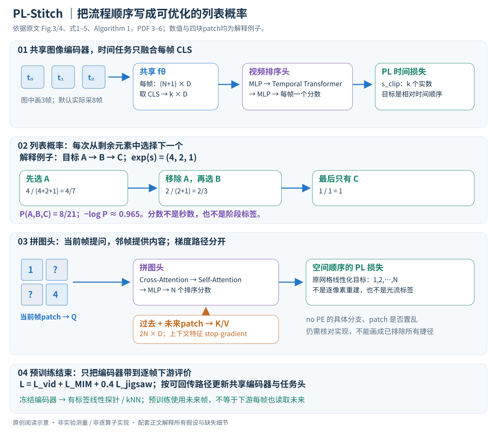

# A Stitch in Time: Learning Procedural Workflow via Self-Supervised Plackett-Luce Ranking

核对日期：2026-10-20。以下实验均为作者报告；本地完成原文阅读与讲解自检，未复现实验。

方法与配图详细版返工：2026-10-23。重读§3–4、Fig.3–4与Algorithm 1；展开PL概率/梯度、两条图像任务、stop-gradient与评价边界，未复现。

## 一句话总结

PL-Stitch用Plackett–Luce序列排序损失学习视频流程先后，并结合跨帧patch拼图和掩码学习，增强冻结特征在手术阶段与烹饪步骤识别上的表现。

## 研究背景与动机

识别画面里有咖啡机，不等于知道磨豆应先于冲泡。常见对比/重建SSL可能对正向与倒序预训练给出相似特征。作者用时间顺序本身作监督，减少人工流程标注。[§1–2，PDF1–3]

正倒序特征距离只是方向敏感的一个诊断，不足以证明模型理解因果流程、必须步骤或临床正确操作。

## 方法总览

### 目标不是输出步骤名称，而是预训练逐帧表示

PL-Stitch接收没有人工阶段标签的视频，训练共享图像编码器\(f_\theta\)。预训练完成后交付的是编码器参数；手术阶段或烹饪动作的类别名称来自后续评价标签，并不是PL排序头自己发现后直接命名。输入视频顺序提供时间监督，图像patch的原始网格位置提供空间监督，两者都不需要人工逐帧阶段注释。（§3.1–3.2、Algorithm 1，PDF第4页）

原创图依据Fig.3–4、式1–5、Algorithm 1，PDF第3–6页。图中的三帧分数、四块patch和概率是解释例子；实际默认时间分支用8帧，空间分支的patch数取决于输入分辨率。图也区分了训练时邻帧上下文和下游逐帧评价，未把解释图当实验结果。

一张图像先切成\(P\times P\)的非重叠patch，经线性投影变为D维token，再加一个可学习CLS。若patch数\(N=HW/P^2\)，编码器输入输出均有N+1个token。CLS用于概括整帧，patch输出保留局部结构。所有分支复用编码器权重，但选取的token和任务头不同。（§3.1、Fig.3，PDF第3–4页）

| 量 | 形状（省略batch） | 去向 |
|---|---|---|
| 单帧 \(v_t\) | \(H\times W\times C\) | 图像编码器 |
| 编码结果 \(E_t\) | \((N+1)\times D\) | CLS送时间头，patch送图像任务 |
| 稀疏片段 \(C_v\) | \(k\times H\times W\times C\) | 默认k=8帧 |
| \(E_{CLS}\) | \(k\times D\) | 只融合整帧摘要 |
| \(s_{clip}\) | \(k\)个实数 | PL时间排序概率的参数 |
| 当前帧patch查询Q | \(N\times D\) | 来自被掩码当前帧 |
| 邻帧patch上下文K/V | \(2N\times D\) | 过去、未来两帧拼接 |
| \(s_{jigsaw}\) | N个实数 | PL空间顺序的参数 |

这里\(P\)是patch边长，后面的\(P(r\mid s)\)是概率符号；不要把二者混淆。表中Q/K/V的D表示头投影前通道，注意力内部可再投影，正文没有给出足以唯一确定所有隐藏宽度的配置。

### 视频分支：把跨帧信息压到CLS之后再融合

先随机选起点\(t_0\)与均匀采样间隔\(\Delta t\)，得到

\[C_v=(v_{t_0},v_{t_0+\Delta t},\ldots,v_{t_0+(k-1)\Delta t}),
\quad t_0+(k-1)\Delta t\le T.\]

“均匀”指同一片段内部间隔相同，不是所有训练样本都固定一个间隔。每帧独立通过共享编码器，再取CLS堆叠成\(k\times D\)。时间头先用MLP降低特征维度，再用Temporal Transformer Encoder聚合k帧，最后MLP为每一帧输出一个标量分数。（§3.4、Fig.4，PDF第3、5页）

若把所有patch都送进时间融合头，序列长度会从k变为约kN。使用CLS能显著减少这个融合阶段的注意力开销，但不消除逐帧ViT提特征的成本。模型因此同时保留两条视角：时间头看整帧在流程里的相对位置，图像头看局部结构对应，而不是让一个特别长的时空Transformer包办全部任务。

分数不是预测的秒数、类别或完成百分比。只要较早帧相对分数更大，目标排序概率就能提高；分数的整体平移没有可观测意义。按论文公式，高分元素会较早被PL分布选择，所以不能把“分数高”默认解释成“发生得晚”。

## 核心创新与关键设计

### PL损失第一层：一次排序看成连续选择剩余元素

设有K个元素，目标顺序为\(r^*\)。PL先在所有元素中选第一个，再从剩余元素中选第二个，直到最后一个。因此

\[P(r\mid s)=\prod_{i=1}^{K}
\frac{\exp(s_{r(i)})}{\sum_{j=i}^{K}\exp(s_{r(j)})},\]

\[L_{PL}(s,r^*)=\sum_{i=1}^{K}
\left[\operatorname{logsumexp}_{j\ge i}(s_{r^*(j)})-s_{r^*(i)}\right].\]

最后一个元素的分子与分母相同，贡献为0。每一步只在尚未选走的集合中归一化，分母随选择缩小；这与“对整组分数做一次softmax，直接输出K个位置标签”不同。（式1–2，PDF第4页）

**逐步算一次。** 目标顺序是A、B、C，令分数\(s=(\log4,\log2,\log1)\)。第一次选A概率4/7；A被选走后，选B概率2/3；最后只剩C，概率1。整个目标排列概率为8/21，负对数损失约0.965。若把B和C的权重交换为\((4,1,2)\)，概率变4/21、损失约1.658；若权重逆向为\((1,2,4)\)，则概率1/21、损失约3.045。这是独立计算的教学例子，不是作者训练日志。

这个例子说明PL能对不同分数/顺序给出连续反馈；它不证明损失对所有排列都严格按交换次数成比例。PL还采用独立于无关备选项的相对偏好建模假设，真实流程里的可交换步骤、分支或循环未必符合一个固定全序。序列概率模型本身也不提供因果正确性的保证。

### PL损失第二层：梯度为什么会推高正确前项？

目标第一位A的分数，出现在第一项分母和对应的负分数中，梯度为\(p_A-1\)；若A选择概率不足，梯度下降就会提高它。B还要参与第一轮竞争，并在移除A后争取第二位，所以同时收到“不要抢A之前”和“要排在C之前”的反馈。不是把所有元素一律推到高分，而是相互竞争地形成排序。

在上面的权重4、2、1例子中，对A、B、C的总梯度分别为\(-3/7,-1/21,10/21\)，三者和为0。这对应整体分数平移不改变概率：\(P(r\mid s+c\mathbf1)=P(r\mid s)\)。这些是对式1–2的独立推导，帮助理解优化，不是正文另给出的新损失。

实现时先按目标顺序重排分数，再计算后缀logsumexp，可在线性数量的后缀操作内完成损失，避免显式指数溢出，也无需枚举K!个排列。但时间Transformer自身仍有\(O(k^2)\)的注意力项；“PL损失不枚举排列”不等于“全网络复杂度线性”。使用平均还是求和、batch归一化等细节需要核对实际实现，尤其空间N远大于时间k时会影响两个任务的量级。

### 时间目标和输入序号之间，仍需核对捷径

Algorithm 1把稀疏采样片段写成时间递增排列，并设\(r^*_{clip}=(1,\ldots,k)\)。文字说要从内容预测正确相对顺序，但本次读到的正文没有明确说明输入是否打乱，以及时间头是否含可直接暴露原序号的位置编码。若模型可以直接读取“输入第几位”并输出递减常数，形式上的排序损失就不足以证明学到流程内容。（Algorithm 1、§3.4，PDF第4–5页）

这不等于已确认实现存在捷径；它说明复现必须验证：置乱输入时目标是否同步置换、打乱后输出是否随内容而非槽位变化、位置编码是否泄露目标。不能为了让讲解看起来完整，就在图中凭空加入论文没写清的随机打乱步骤。

### 图像分支之一：MIM维持单帧语义能力

对当前帧\(v_t\)做块状掩码，默认掩30%。MIM沿用iBOT的目标，让编码器不能只靠少数流程线索而丢掉局部/整帧语义。它是一条与排序并列的表示学习任务，而不是PL损失的第三种排列。（§3.5、§4.1，PDF第5–6页）

正文将MIM作为已有iBOT目标引用，没有逐项展开教师更新、投影分布、中心化和温度等训练细节。本笔记不把它直接换成像素MSE，也不把自选iBOT配置称为本文精确实现。Fig.3区分了带位置编码的MIM路径与标注no PE的拼图路径；不能因此简单删除整个ViT所有任务的位置编码。

### 图像分支之二：用邻帧内容帮助当前patch恢复顺序

再采样\((v_{t-\tau_1},v_t,v_{t+\tau_2})\)。当前帧被掩码后的patch特征作为Q；过去、未来帧的patch特征沿token维拼接，形成K和V。拼图头依次执行Cross-Attention、Self-Attention和MLP：先把邻帧证据写入当前查询，再让当前patch彼此交流，最后每个当前patch输出一个排序分数。（§3.5、Fig.3–4，PDF第3、5页）

把注意力单头形式写成通用背景公式：

\[A=\operatorname{softmax}\!\left(\frac{QW_Q(KW_K)^\top}{\sqrt{d_h}}\right),
\quad H=A(VW_V).\]

若Q有N行、K/V有2N行，则A有\(N\times2N\)个权重；每个当前patch能从前后两帧寻找视觉证据。这里的\(W_Q,W_K,W_V,d_h\)只是帮助理解cross-attention的标准记号，不代表本文公开了逐层宽度或完整残差/归一化实现。仅因为K/V来自邻帧，也不能宣称注意力权重就是精确光流或真实物体轨迹。

**Fig.3还画了重要的梯度边界：**邻帧编码结果到K/V前有stop-gradient标记。按该图，拼图损失不会沿这两条上下文特征路径回传到其编码计算；它仍可通过当前查询路径更新共享编码器，通过任务头更新头参数。共享权重也会受其他分支更新，所以stop-gradient不等于“整个编码器冻结”，更不等于“上下文图像没有信息”。（原图视觉核对，PDF第3页）

### patch排序究竟恢复了什么？

设一张小图只有2×2个patch，原网格按行展开是\((a,b,c,d)\)。拼图头输出四个分数，使这个原始顺序的PL概率提高；训练目标来自原位置索引，而不是手术阶段标签。被遮挡的patch可借邻帧相应内容得到线索，因此作者希望它学到对象对应和空间关系。（式4、§3.5，PDF第5页）

但目标只是一个线性化全序，不能直接等同于预测二维坐标、恢复全部像素或求出唯一几何对应。若a和b外观极相似，单帧内容可能无法决定左右；邻帧提供的证据也受相机运动、遮挡和器械交互影响。对这种歧义，固定单一排列并没有显式表达多个同样合理的答案。

作者说拼图省略位置编码以减少位置捷径，Fig.3也标出no PE路径。正文没有完整说明patch是否置乱、编码器内去PE的具体调用方式、padding或裁剪是否泄露位置等细节。若当前patch仍能直接读到原网格位置，排序任务可能过于容易；若真的完全去掉所有位置线索，重复纹理又可能导致不可识别。这些实现取舍需要读源码后再结论，不能由一张箭头图推断已经处理完毕。

### 三个损失怎样一起训练？

总目标是

\[L=L_{vid}+L_{MIM}+0.4L_{jigsaw}.\]

它们共享\(f_\theta\)，并分别通过\(h_{vid},h_{MIM},h_{jigsaw}\)产生任务输出。时间目标鼓励阶段进程差异，MIM保持语义，拼图补局部对应。对共享权重的梯度是各路径梯度的加权和；系数0.4只是该配置的任务权重，并不能单凭数值断言拼图影响一定最小，因为原损失尺度和梯度范数也不同。（式5、Algorithm 1，PDF第4、6页）

每次训练采样视频片段和图像三元组，视频与图像任务对应不同视野尺度。邻帧偏移分别从过去1.5–2.5秒、未来1.5–2.5秒范围采样；不是固定相邻一帧，更不是把8帧时间片段也全部限制在这个几秒窗口。长程流程排序与局部对应通过共享编码器汇合，而不是把这两个时间尺度混为一谈。（§4.1，PDF第6页）

### 下游如何使用，未来帧会不会被带入评价？

预训练结束后，论文返回编码器参数，评价时冻结backbone。线性探针用有标签训练集拟合线性分类器；kNN利用有标签训练特征和k=20邻居作分类。两者都不是“没有用任何类别标签”的完整识别流程，无标签指的是预训练表示学习阶段。（Algorithm 1、Table 1–2、§4.1，PDF第4–6页）

正文说明各任务按帧作预测。因此不能因为预训练拼图看过未来帧，就说下游分类必须等未来帧到达；也不能反过来把训练阶段说成严格在线因果。实际线上延迟、整段后处理、视频级拆分和跨域外推仍需分别评估。

### 成本、适用前提与复现边界

时间头用k个CLS，注意力矩阵约k×k；拼图cross-attention用N×2N，随后当前patch self-attention约N×N。以纯解释设置H=W=224、P=16为例，N=196，跨帧注意力每头有76,832个配对，而8帧时间头只有64个配对；它们的通道、层数、encoder开销不同，不能据此直接比较实际耗时。正文没有完整提供所有头参数，未复现时不报自测吞吐或显存。

这套方法更适合具有相对稳定流程的训练域。可选步骤、循环返工、可交换动作和跨机构风格变化，可能使“一个正确全序”成为过强假设。消融可以支持任务组合对所测基准有效，却不能单靠排序损失和注意力图证明模型理解了操作因果或临床安全。

精确复现优先核对两种排序的输入置乱与目标同步、PE分支、邻帧stop-gradient、MIM细节、PL数值稳定性及归一化；再按原数据划分训练和评价，分别记录主实验ViT-B/16与消融ViT-S/16。本篇完成原文重读、图与公式核对、数值例子自检，**未运行上游代码或复现实验**。

## 实验与关键结果

主实验ViT-B16，手术在LEMON预训练30epoch、batch240、AdamW4e−4；烹饪在各自官方训练集100epoch，4×A10040GB。冻结编码器做线性和k20近邻评估。[PDF5–7]

| 作者结果 | iBOT | PL-Stitch |
| --- | --- | --- |
| Cholec80线性Acc↑ | 74.6 | 80.4 |
| Cholec80 kNN Acc↑ | 70.3 | 81.7 |
| AutoLaparo kNN↑ | 75.3 | 82.5 |
| Breakfast线性Acc↑ | 15.7 | 21.6 |

来源Table1–2。Breakfast对最佳DINO15.9的提升5.7点，绝对21.6仍很低；F1@50本文3.2低于DINO3.6，不能说每个步骤分割指标都第一。手术识别研究不是临床操作建议。

## 消融实验与证据强度

消融改用ViT-S16，不可与主结果直接混成同一模型。MIM基线kNN69.4，加时间排序78.9，加jigsaw而无时间71.4，完整80.2；时间目标贡献最大但两分支互补。[Table3，PDF6]

时间排序pairwise/排列CE/PL的线性75.8/74.5/77.1，kNN75.4/70.1/78.9。4/8/16帧kNN78.1/80.2/80.3，16帧只微增而计算增加，默认8帧是效率折中，不是绝对精度最优。[Table4–5]

## 局限与讨论

训练与评价集中在有稳定流程结构的手术和烹饪域，循环、可交换步骤和分支流程可能不符合简单全序假设。相似视觉阶段仍难分，顺序敏感也可能来自外观或时间捷径；应另检验相同动作不同步骤和跨机构偏移。

去位置编码的具体位置及序列打乱需源码验证；未本地训练，未阅读补充材料中的权重敏感性和额外图。

## 复现提示

代码 `https://github.com/visurg-ai/PL-Stitch`，commit和许可待核。检查视频按人/手术或官方split隔离、帧率和采样时间、排序目标与输入置乱的一致性；稳定实现PL损失并测试接近顺序与完全乱序。分别记录主ViT-B与消融ViT-S的条件。

建议 `data/procedural-video/pl-stitch/`，涉及手术视频按原数据访问协议获取，不上传原视频或个人医疗资料。这里只作研究解析。

## 相关工作与阅读顺序

先读iBOT的MIM，再读PL列表排序的逐步选择概率，之后看跨帧拼图。把“无标注预训练”和“有标注线性探针评价”区分，避免把所有下游识别也称完全无监督。

## 来源与校验

- [CVF 官方论文页](https://openaccess.thecvf.com/content/CVPR2026/html/Che_A_Stitch_in_Time_Learning_Procedural_Workflow_via_Self-Supervised_Plackett-Luce_CVPR_2026_paper.html) · [所读 PDF](https://openaccess.thecvf.com/content/CVPR2026/papers/Che_A_Stitch_in_Time_Learning_Procedural_Workflow_via_Self-Supervised_Plackett-Luce_CVPR_2026_paper.pdf)。页码均为该 PDF 的页序。
- 阅读范围：正文、公式与实验表；补充材料、上游代码与权重未逐项核验。许可证和固定代码 commit 尚未确认，不复制原文全文或数据。
- PDF SHA-256：`6bd0b682d6edca2761105ea95777e3dba528df424c23f91ecbfbba64561ce09a`；版本为本次下载的 CVF 接收稿，核对日期 2026-10-20。
