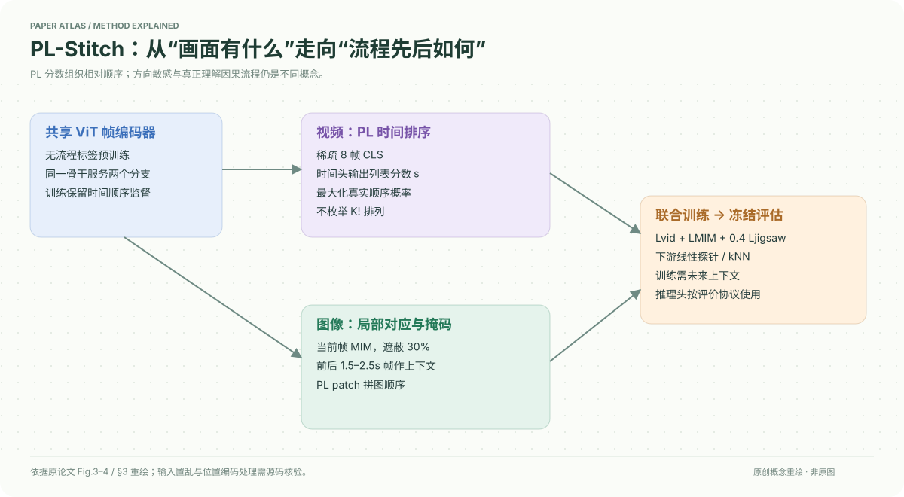

# A Stitch in Time: Learning Procedural Workflow via Self-Supervised Plackett-Luce Ranking

核对日期：2026-10-20。以下实验均为作者报告；本地完成原文阅读与讲解自检，未复现实验。

## 一句话总结

PL-Stitch用Plackett–Luce序列排序损失学习视频流程先后，并结合跨帧patch拼图和掩码学习，增强冻结特征在手术阶段与烹饪步骤识别上的表现。

## 研究背景与动机

识别画面里有咖啡机，不等于知道磨豆应先于冲泡。常见对比/重建SSL可能对正向与倒序预训练给出相似特征。作者用时间顺序本身作监督，减少人工流程标注。[§1–2，PDF1–3]

正倒序特征距离只是方向敏感的一个诊断，不足以证明模型理解因果流程、必须步骤或临床正确操作。

## 方法总览

共享ViT提帧特征。视频分支用稀疏8帧CLS预测PL排序分数；图像分支同时学习当前帧掩码表征，以及用前后帧patch帮助当前patch顺序恢复的jigsaw。只保留编码器用于下游冻结特征评估。[Fig.3–4、§3，PDF3–6]

## 核心创新与关键设计

K个元素的目标顺序r概率：
\[P(r|s)=\prod_{i=1}^K\frac{\exp(s_{r(i)})}{\sum_{j=i}^K\exp(s_{r(j)})},\quad L_{PL}=-\log P(r^*|s).\]
可用后缀logsumexp稳定计算，无需枚举K!排列。相对次序的列表目标不同于每对独立比较或给整排列一个离散类标签。[式1–3]

视频head以CLS降低计算；拼图query取掩码当前帧，K/V取前后帧patch，强调去位置编码防止捷径。正文按时间顺序采帧并以(1,…,k)为目标，实际打乱输入和头中位置编码的处理需核对实现，避免模型直接读取序号。[Algorithm1、§3.4–3.5]

总目标L_vid+L_MIM+0.4L_jigsaw；过去/未来帧偏移约1.5–2.5s，MIM遮30%。这些未来帧用于训练，不代表部署单帧分类也使用未来信息。[§4.1]

## 实验与关键结果

主实验ViT-B16，手术在LEMON预训练30epoch、batch240、AdamW4e−4；烹饪在各自官方训练集100epoch，4×A10040GB。冻结编码器做线性和k20近邻评估。[PDF5–7]

| 作者结果 | iBOT | PL-Stitch |
| --- | --- | --- |
| Cholec80线性Acc↑ | 74.6 | 80.4 |
| Cholec80 kNN Acc↑ | 70.3 | 81.7 |
| AutoLaparo kNN↑ | 75.3 | 82.5 |
| Breakfast线性Acc↑ | 15.7 | 21.6 |

来源Table1–2。Breakfast对最佳DINO15.9的提升5.7点，绝对21.6仍很低；F1@50本文3.2低于DINO3.6，不能说每个步骤分割指标都第一。手术识别研究不是临床操作建议。

## 消融实验与证据强度

消融改用ViT-S16，不可与主结果直接混成同一模型。MIM基线kNN69.4，加时间排序78.9，加jigsaw而无时间71.4，完整80.2；时间目标贡献最大但两分支互补。[Table3，PDF6]

时间排序pairwise/排列CE/PL的线性75.8/74.5/77.1，kNN75.4/70.1/78.9。4/8/16帧kNN78.1/80.2/80.3，16帧只微增而计算增加，默认8帧是效率折中，不是绝对精度最优。[Table4–5]

## 局限与讨论

训练与评价集中在有稳定流程结构的手术和烹饪域，循环、可交换步骤和分支流程可能不符合简单全序假设。相似视觉阶段仍难分，顺序敏感也可能来自外观或时间捷径；应另检验相同动作不同步骤和跨机构偏移。

去位置编码的具体位置及序列打乱需源码验证；未本地训练，未阅读补充材料中的权重敏感性和额外图。

## 复现提示

代码 `https://github.com/visurg-ai/PL-Stitch`，commit和许可待核。检查视频按人/手术或官方split隔离、帧率和采样时间、排序目标与输入置乱的一致性；稳定实现PL损失并测试接近顺序与完全乱序。分别记录主ViT-B与消融ViT-S的条件。

建议 `data/procedural-video/pl-stitch/`，涉及手术视频按原数据访问协议获取，不上传原视频或个人医疗资料。这里只作研究解析。

## 相关工作与阅读顺序

先读iBOT的MIM，再读PL列表排序的逐步选择概率，之后看跨帧拼图。把“无标注预训练”和“有标注线性探针评价”区分，避免把所有下游识别也称完全无监督。

## 来源与校验

- [CVF 官方论文页](https://openaccess.thecvf.com/content/CVPR2026/html/Che_A_Stitch_in_Time_Learning_Procedural_Workflow_via_Self-Supervised_Plackett-Luce_CVPR_2026_paper.html) · [所读 PDF](https://openaccess.thecvf.com/content/CVPR2026/papers/Che_A_Stitch_in_Time_Learning_Procedural_Workflow_via_Self-Supervised_Plackett-Luce_CVPR_2026_paper.pdf)。页码均为该 PDF 的页序。
- 阅读范围：正文、公式与实验表；补充材料、上游代码与权重未逐项核验。许可证和固定代码 commit 尚未确认，不复制原文全文或数据。
- PDF SHA-256：`6bd0b682d6edca2761105ea95777e3dba528df424c23f91ecbfbba64561ce09a`；版本为本次下载的 CVF 接收稿，核对日期 2026-10-20。

- 视觉核对：已渲染查看 PDF第6页并核对原表、算法或公式；独立补充材料未读，实验未复现。
