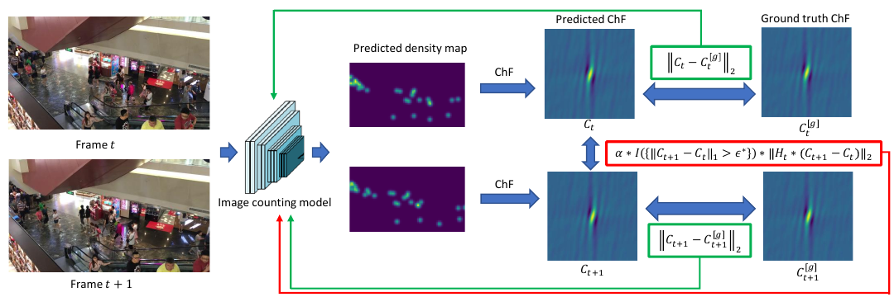

# Adapting Lightweight Image-based Counting Models for Video Crowd Counting

核对日期：2026-10-22。实验数值均为作者报告；本地完成原文阅读与讲解自检，未复现实验。

## 一句话总结

SR把相邻帧人群密度变化的频域统计做成训练正则，让轻量单帧模型获得更好的视频计数能力；推理仍只看当前帧，因此没有真正增加被遮挡场景的时间观测信息。（PDF第1–7页）

## 研究背景与动机

多帧视频计数需要缓存、时空融合或光流网络，增加推理成本。作者选择把相邻帧信息放在训练约束中，部署仍保留单图密度预测器。关键是不能强迫两帧密度完全一样：人会移动、进出画面，相邻帧本来就有合理变化，因此约束需要数据驱动阈值与运动容忍权重。（PDF第1–4页）

## 方法总览

原论文Fig.1，PDF第3页。仅裁切相关图示，保留图内科学标签；著作权属于原作者，用于本篇方法分析，不并入本站原创图授权。[来源与作者](https://openaccess.thecvf.com/content/CVPR2026/html/Shu_Adapting_Lightweight_Image-based_Counting_Models_for_Video_Crowd_Counting_CVPR_2026_paper.html) · [PDF](https://openaccess.thecvf.com/content/CVPR2026/papers/Shu_Adapting_Lightweight_Image-based_Counting_Models_for_Video_Crowd_Counting_CVPR_2026_paper.pdf)。点击可打开高清图。

图1中两帧独立经过同一计数模型，密度图转成频域ChF，一方面分别与标注ChF监督，另一方面仅在预测变化过大时惩罚跨帧差异。阈值ε*和运动统计Λ*预先从训练标注估计，不需要标注个体匹配。推理移除整个跨帧损失，每帧直接得到密度图与总人数；它不是额外的时间融合模块。（PDF第3–6页）

## 核心创新与关键设计

频域表征满足零频值 \(C_t(0)\)等于人数，因此这里不应把它误解成总质量归一为1的概率特征函数。阈值初始定义为训练相邻帧 \(\|C_{t+1}-C_t\|_1\)最大值，实际还使用附录中的抗离群修正。总损失可写成

\[L'=L_g+\alpha\,\mathbf1(\|\Delta C\|_1>\epsilon^*)\,\|H_t\odot\Delta C\|_2.\]

H按正常运动引起的频率波动降权，并加1稳定分母；Λ通过训练ChF变化的经验方差拟合半正定运动协方差，而不是直接跑光流。（PDF第4–6页）

定理4比较最优多帧与单帧条件期望，其差为 \(\mathbb E|\mathbb E[C_t|I_{t-l:t+r}]-\mathbb E[C_t|I_t]|^2\)。只有邻帧不再提供额外条件信息等充分条件下差为零。这是理想最优估计器的界，不保证有限容量VGG达到同等精度；图像还有部分身体线索也不自动推出人数完全可确定。（PDF第6–7页）

## 实验与关键结果

六个数据集含UCSD、MALL、VENICE、FDST、DRONECROWD及VSCROWD。默认VGG19计数骨干，α0.8、密度高斯带宽8px，Adam学习率10⁻⁵、weight decay10⁻⁴，batch8即四对帧；频域积分用[-0.3,0.3]²和0.01步长。论文把“MSE”定义为root mean square error，以下记RMSE，避免误读成均方误差。（PDF第7页）

| 表5 / 作者报告 | MAE↓ | RMSE↓ |
|---|---:|---:|
| UCSD | 0.75 | 0.97 |
| VENICE | 8.2 | 10.5 |
| MALL | 1.43 | 1.82 |
| FDST | 1.27 | 1.61 |
| DRONECROWD | 14.1 | 19.9 |
| VSCROWD | 5.4 | 9.5 |

DRONECROWD的STNNet RMSE18.7仍低于SR19.9，UCSD的CLRNet0.72/0.94也更好，不是六集全指标第一。FDST 640×360、RTX3090Ti上推理0.010秒/帧、99.5fps，训练85.5秒/epoch；这不是全高清、任意硬件或摄像头端到端帧率。（表6，PDF第8页）

## 消融实验与证据强度

表3 DRONECROWD基线MAE18.1/RMSE26.5，加基本正则15.3/22.7，加运动容忍14.1/19.9。正文把基本正则MAE写为15.2，与表3的15.3有差异，这里保留表格值。α从0.8提高到3时MAE14.1→16.5，过强约束会限制合理运动变化。（PDF第7页）

表4的架构迁移：MCNN34.7→30.6，CSRNet19.8→17.1，CAN22.1→16.9，VGG1918.1→14.1，MAN18.7→14.9，支持该训练约束并非只适用于一个骨干。表中没有误差条，不能把每一点改善解释成跨所有随机种子的确定收益。

## 局限与讨论

训练阈值不是未来数据的硬上界，镜头切换、帧率变化、快速人流与标注异常都可能导致分布外变化。有限频域积分只是理论连续积分的近似，影响阈值与正则强度。单帧无法利用邻帧补充当前不可见人物，理论充分条件也未对六个数据集逐一证明。自动估计ε*/Λ*降低部分调参成本，但α、带宽与积分范围仍是设计选择，不能称为完全无超参数。（PDF第4–8页）

## 复现提示

正文将代码入口记为`wbshu/SR`，本轮未独立核验仓库链接、commit、许可证或补充实现，未下载人群视频和运行计数。复现应只用训练标注估计统计量，并保证同一帧对的裁剪、翻转、坐标尺度一致；核对抗离群阈值、频域离散化、计数非负性与运动权重的梯度处理。性能测试应分开计入解码/预处理与网络推理，目前99.5fps仅为作者报告。（PDF第5–8页）

## 相关工作与阅读顺序

先理解密度图积分计数，再读ChfL如何在频域监督单图计数，随后理解SR新增的时间差分统计。与光流融合、ConvLSTM和STGN比较时，分别统计训练需要的标注和推理需要的帧。方法的实际价值是在给定数据条件下改善精度/效率折中，而不是证明视频信息永远没有价值。（PDF第2–8页）

## 来源与校验

- [CVF官方论文页](https://openaccess.thecvf.com/content/CVPR2026/html/Shu_Adapting_Lightweight_Image-based_Counting_Models_for_Video_Crowd_Counting_CVPR_2026_paper.html) · [所读PDF](https://openaccess.thecvf.com/content/CVPR2026/papers/Shu_Adapting_Lightweight_Image-based_Counting_Models_for_Video_Crowd_Counting_CVPR_2026_paper.pdf)。页码均为PDF页序。
- 所读版本：2026-10-22从CVF下载的开放接收稿；PDF SHA-256：`a030dfd62fed8884b348fef466b138ea3d535d5ea50c493f6955c942d57db68f`。
- 阅读范围：正文、方法公式、实验与消融；补充材料、代码及权重未逐项核验。reviewed表示本地讲解自检，不表示独立同行评审或实验复现。
- 方法图与关键公式/表格已渲染核对，所引原图已单独检查；未对新文章进行浏览器交互验收。作者图示与本站原创素材权利分开记录。
