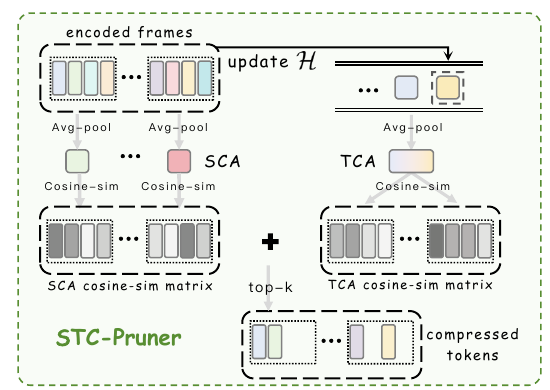

# Accelerating Streaming Video Large Language Models via Hierarchical Token Compression

核对日期：2026-10-21。实验数值均为作者报告；本地完成原文阅读与讲解自检，未复现实验。

## 一句话总结

STC先在ViT中缓存静态token、只更新动态区域，再用当前帧与历史双锚点裁减视觉token，同时压缩视觉编码与LLM预填充成本。

## 研究背景与动机

仅减少送入LLM的token无法省掉逐帧ViT编码。流式场景相邻帧重复多、未来内容与用户问题又未知，因此需要不依赖未来帧或查询的缓存和选择策略。[§1–2，PDF1–3]

0.5fps的研究协议仍是稀疏帧输入，不能直接证明高帧率连续视频的实时理解；任务准确率保留比例也不是绝对准确率。

## 方法总览

原论文 Fig.6，PDF第5页。仅裁切相关图示，保留图内科学标签，著作权属于原作者；用于本篇方法分析，不并入本站原创图授权。[来源与作者](https://openaccess.thecvf.com/content/CVPR2026/html/Wang_Accelerating_Streaming_Video_Large_Language_Models_via_Hierarchical_Token_Compression_CVPR_2026_paper.html) · [PDF](https://openaccess.thecvf.com/content/CVPR2026/papers/Wang_Accelerating_Streaming_Video_Large_Language_Models_via_Hierarchical_Token_Compression_CVPR_2026_paper.pdf)。点击可打开高清图。

本图专门展示Pruner的双锚点机制；Cacher在ViT内，位于图示Pruner之前。

Cacher每隔N帧建立参考，在各ViT层缓存K、V、注意力和MLP特征，按当前与参考Key余弦变化选动态token更新，其余复用。Pruner在视觉编码后，用历史W帧的平均特征TCA与当前帧全局均值SCA评分并保留高新颖token。[Fig.3–6、§3，PDF3–6]

两个模块作用不同：缓存不等于删除视觉内容，Pruner才缩短LLM序列；端到端在线基线主要接入Cacher，ReKV同时测试两者。

## 核心创新与关键设计

按式8而非附近“product”措辞，新颖分数是加权和：
\[S(z_j)=\alpha[1-\cos(z_j,a_{temporal})]+(1-\alpha)[1-\cos(z_j,a_{spatial})].\]
高分代表偏离过去平均和当前平均，但不保证对未知未来问题重要；罕见文字或静态关键物体仍可能被错删。[PDF6]

**复现符号需核验**：正文将RPruner称裁减比例，式k=⌊N(1-RPruner)⌋，却又举R=25%时保留25%的例子；§4明确单Pruner裁掉75%、联合裁掉70%，此处按实验设置解释，不能把两种比例混用。

Cacher式4定义Q/V，文字却称Q/K；式5更新V却称构建K，式6又用未在同处定义的Kbar和Vcurr。因此本笔记解释“选择更新+缓存补齐”的意图，不提供假装精确的QKV实现。Cacher R=75%表示复用75%、重算25%。[式1–7，PDF5]

## 实验与关键结果

ReKV以LLaVA-OV7B为骨干，0.5fps；单Cacher N4/R75%，联合N2/R75%、Pruner裁减70%。表列ViT编码16帧时间与LLM预填充时间单位为秒，具体硬件细节正文不充分，不能擅自改为毫秒。[§4、Table1–3，PDF6–7]

| 作者报告：ReKV | 基线 | Cacher+Pruner |
| --- | --- | --- |
| OVO总体↑ | 52.6 | 52.0 |
| StreamingBench总体↑ | 69.1 | 65.2 |
| 长视频三基准平均↑ | 61.3 | 60.8 |
| ViT编码时间秒↓ | 103.7 | 78.3 |
| LLM预填充时间秒↓ | 482.4 | 263.7 |

OVO保留52.0/52.6≈98.9%的基线分数，并不是99%绝对正确。StreamingBench下降3.9pp，不能将OVO的99%保留推广到全部基准。两个阶段降时24.5/45.3%，不能相加成整体69.8%；实际端到端还含投影、缓存维护和解码。

## 消融实验与证据强度

Table4只复用attention的EPM为2.7、只复用MLP49.8、两者54.2，但前两者R85%、联合R75%，压缩强度也改变，不能完全归因为模块组合。[PDF8]

双锚点消融STU48.9优于单空间47.2、单时间47.8，EPM51.2却低于单时间51.5；收益并非逐项稳定。单Pruner长视频平均61.8高于联合60.8，说明编码缓存与选择叠加也可能损失质量。[Table3、5]

## 局限与讨论

镜头跳变、细小目标变化和长期静态证据可能被缓存或均值锚点误判。按位置比较Key需要处理相机运动，否则同一位置未必同一内容。未知问题意味着查询无关压缩必然可能丢弃后来需要的信息。

没有无限流时长误差保证；KV内存管理仍依赖基底系统。论文计时不能直接证明消费级硬件的实时速度，未读补充材料与未运行实现使QKV和比率歧义仍待解决。

## 复现提示

[作者代码入口](https://github.com/lern-to-write/STC)来自正文。先核对保留率/裁减率、QKV缓存张量、参考帧刷新、空历史与时间戳映射，检查任何锚点只用已到达帧，再测动态/静态关键事件与镜头切换。

建议 `experiments/streaming-video/stc/`，仅使用获许可公开视频；不录制用户屏幕或上传私人视频。本次未核验commit/许可证，也未运行模型，论文数值全部为作者报告。

## 相关工作与阅读顺序

先理解视觉编码、投影、预填充和解码四阶段，再读ReKV，随后分开看Cacher与Pruner。最后把Table1的98.9%保留、Table2实际下降和Table3联合消融放在一起评估。

## 来源与校验

- [CVF官方论文页](https://openaccess.thecvf.com/content/CVPR2026/html/Wang_Accelerating_Streaming_Video_Large_Language_Models_via_Hierarchical_Token_Compression_CVPR_2026_paper.html) · [所读PDF](https://openaccess.thecvf.com/content/CVPR2026/papers/Wang_Accelerating_Streaming_Video_Large_Language_Models_via_Hierarchical_Token_Compression_CVPR_2026_paper.pdf)。页码均为PDF页序。
- 所读版本：2026-10-21从CVF下载的开放接收稿；PDF SHA-256：`4c8d3f913a0f543c9a520e99b44b28acf656ae0b9a1ea38a7f541b0dc290aa60`。
- 阅读范围：正文、方法公式、实验与消融；补充材料、代码及权重未逐项核验。reviewed表示本地讲解自检，不表示独立同行评审或实验复现。
- 关键公式/算法/表格页面已渲染核对，所引原图已单独检查；作者图示与本站原创素材权利分开记录。
